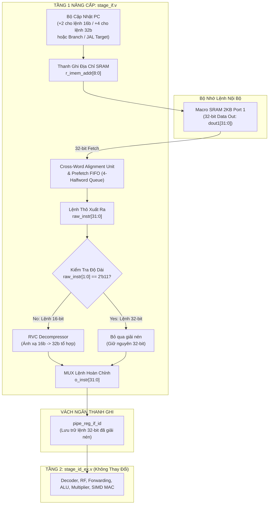

# Kế Hoạch Triển Khai Chi Tiết - Giai Đoạn 4 (PHASE 4)
## Tối Ưu Hóa Mật Độ Mã Lệnh, Băng Thông Nạp Lệnh & Hàng Đợi Nạp Trước (RV32C Compressed Instruction Extension & Instruction Prefetch Buffer)

**Dự án:** RISC-V 32-bit IoT & AI Accelerator Core (`riscv_core_top`)  
**Thời gian thực hiện:** Giai đoạn 4 (Phase 4)  
**Quy trình công nghệ:** SkyWater 130nm High-Density (`sky130_fd_sc_hd`) + SRAM Macro 2KB Dual-Port (`sky130_sram_2kbyte_1rw1r_32x512_8`)  
**Bộ công cụ EDA:** OpenLane 2 (Yosys 0.46, OpenROAD, TritonRoute, KLayout 0.29), Verilator 5.024, QuestaSim 2021.2  

---

## 1. Tổng Quan & Mục Tiêu Chiến Lược Của Giai Đoạn 4

### 1.1. Bối Cảnh Hiện Trạng Sau Khi Hoàn Thành Phase 3
Sau khi hoàn tất Giai đoạn 3 với vi kiến trúc **Đường ống 3 tầng (3-Stage Pipeline)**, mạng chuyển tiếp dữ liệu đầy đủ (**Full Forwarding Network**), bộ nhân tuần tự 8 chu kỳ (**8-Cycle Sequential Multiplier**) và cơ chế bẻ gãy phục hồi rẽ nhánh 2 chu kỳ (**2-Cycle Pipelined BRMP**):
- **Tần số cực đại:** Đạt $66.69\text{ MHz}$ ở góc Typical TT và **$96.15\text{ MHz}$** ở góc Fast-Fast FF trên tiến trình SkyWater 130nm.
- **Độ tin cậy vật lý:** 0 lỗi DRC, Hold Slack $+0.0238\text{ ns}$ (sạch 100%), diện tích stdcell giảm xuống mức tối ưu **$154,622\,\mu\text{m}^2$** (Core utilization: $31.6\%$).
- **Khối SIMD AI:** Khối `smdot.i8` duy trì độ trễ 1 chu kỳ, đạt tốc độ tăng tốc mạng nơ-ron **13.91x**.

### 1.2. Nút Thắt Về Bộ Nhớ Trong Ứng Dụng IoT & AI Thực Tế
Mặc dù hiệu năng tính toán đã đạt mức rất cao, hệ thống vi điều khiển IoT của chúng ta đang đối mặt với rào cản tài nguyên bộ nhớ cực kỳ nghiêm ngặt:
1. **Dung lượng SRAM nội bộ hạn chế (2KB = 512 words x 32 bits):**
   - SRAM 2KB phải dùng chung cho cả vùng mã lệnh (**Instruction Space**), vùng dữ liệu biến toàn cục/ngăn xếp (**Data & Stack**), và vùng đệm mảng trọng số mạng nơ-ron (**AI Weights/Activations**).
   - Với tập lệnh thuần 32-bit (RV32I/M), mỗi lệnh chiếm trọn $4\text{ bytes}$. Một chương trình firmware IoT kèm mô hình AI cơ bản có thể dễ dàng chiếm từ $1.5\text{ KB} - 1.8\text{ KB}$, đẩy hệ thống vào nguy cơ tràn bộ nhớ SRAM.
2. **Lãng phí băng thông cổng đọc SRAM Port 1:**
   - Cổng Port 1 của macro SRAM có độ rộng $32\text{ bits}$. Với lệnh 32-bit truyền thống, mỗi chu kỳ nạp lệnh chỉ đọc được đúng 1 lệnh duy nhất.
   - Khi gặp các lệnh điều khiển luồng hoặc nạp lệch, cổng SRAM phải liên tục kích hoạt ở mọi chu kỳ xung nhịp, làm tăng công suất động (dynamic switching power) của macro bộ nhớ.

### 1.3. Mục Tiêu Đột Phá Của Phase 4
- [ ] **Tích hợp tập lệnh nén chuẩn RISC-V "C" (RV32C Extension):** Hỗ trợ giải nén toàn bộ các lệnh 16-bit thông dụng của chuẩn RV32C, giúp **tiết kiệm từ 25% đến 30% dung lượng SRAM mã lệnh**.
- [ ] **Thiết kế khối giải nén RVC Decompressor không trễ (Zero-Cycle Combinational Expander):** Chuyển đổi lệnh 16-bit thành lệnh 32-bit tương đương một cách trong suốt trước khi cấp cho tầng thực thi, bảo toàn 100% cấu trúc Stage 2/Stage 3 hiện tại.
- [ ] **Tích hợp bộ đệm nạp lệnh trước (Instruction Prefetch Buffer & Alignment Unit):**
  - Tận dụng bus 32-bit từ SRAM Port 1 để nạp cùng lúc **hai lệnh 16-bit trong 1 chu kỳ clock**.
  - Xử lý hoàn hảo các trường hợp **nạp lệch ranh giới (Unaligned Instruction Fetch)** khi lệnh 32-bit bắt đầu tại địa chỉ lẻ ($PC[1] == 1$).
  - Duy trì hàng đợi lệnh liên tục, giảm thiểu chu kỳ stall khi nạp lệnh, hướng tới CPI thực tế tiệm cận lý tưởng **$1.05 - 1.15$**.
- [ ] **Giữ nguyên 100% các thành tựu của Phase 1, 2, 3:** Không làm hồi quy (regression) các bộ kiểm thử hiểm hóc, bảo toàn tính toàn vẹn vật lý với 0 lỗi DRC trên OpenLane 2.

---

## 2. Kiến Trúc Phần Cứng & Nguyên Lý Hoạt Động (Architecture & Hardware Design)

### 2.1. Sơ Đồ Khối Tầng Nạp Lệnh Nâng Cấp (Phase 4 IF Unit with Prefetch Buffer)



---

### 2.2. Phân Tích Kỹ Thuật: Cơ Chế Giải Nén Chuẩn RV32C (Decompressor Logic)

Theo tài liệu chuẩn *The RISC-V Instruction Set Manual - Volume I: Unprivileged ISA*, các lệnh nén 16-bit sử dụng 2 bit thấp `[1:0]` làm Quadrant Selector:
- **Quadrant 0 (`inst[1:0] == 2'b00`):**
  - `c.addi4spn` $\longrightarrow$ `addi rd', x2, nzuimm`
  - `c.lw` $\longrightarrow$ `lw rd', offset(rs1')`
  - `c.sw` $\longrightarrow$ `sw rs2', offset(rs1')`
- **Quadrant 1 (`inst[1:0] == 2'b01`):**
  - `c.nop` / `c.addi` $\longrightarrow$ `addi rd, rd, imm`
  - `c.jal` (chỉ RV32) $\longrightarrow$ `jal x1, offset`
  - `c.li` $\longrightarrow$ `addi rd, x0, imm`
  - `c.addi16sp` $\longrightarrow$ `addi x2, x2, nzimm`
  - `c.lui` $\longrightarrow$ `lui rd, nzimm`
  - `c.srli`, `c.srai`, `c.andi` $\longrightarrow$ Các lệnh dịch bit và logic số học với hằng số
  - `c.sub`, `c.xor`, `c.or`, `c.and` $\longrightarrow$ Các thao tác thanh ghi 2 ngôi
  - `c.j` $\longrightarrow$ `jal x0, offset`
  - `c.beqz`, `c.bnez` $\longrightarrow$ Rẽ nhánh so sánh với thanh ghi `x0`
- **Quadrant 2 (`inst[1:0] == 2'b10`):**
  - `c.slli` $\longrightarrow$ `slli rd, rd, shamt`
  - `c.lwsp` $\longrightarrow$ `lw rd, offset(x2)` (Nạp nhanh từ stack pointer)
  - `c.jr` $\longrightarrow$ `jalr x0, 0(rs1)` (Nhảy thanh ghi không lưu vết)
  - `c.mv` $\longrightarrow$ `add rd, x0, rs2` (Chuyển dữ liệu thanh ghi)
  - `c.ebreak` $\longrightarrow$ `ebreak`
  - `c.jalr` $\longrightarrow$ `jalr x1, 0(rs1)` (Gọi hàm qua con trỏ)
  - `c.add` $\longrightarrow$ `add rd, rd, rs2`
  - `c.swsp` $\longrightarrow$ `sw rs2, offset(x2)` (Lưu nhanh vào stack pointer)

> [!NOTE] Tính Trong Suốt Tuyệt Đối Của RVC Decompressor
> Khối giải nén RVC là một mạng logic tổ hợp thuần túy (Pure Combinational Logic) không chứa thanh ghi, không có chu kỳ chờ ($0\text{-cycle delay}$). Ngõ ra của Decompressor là một lệnh 32-bit chuẩn xác tuân thủ 100% định dạng RV32I. Do đó, **toàn bộ Tầng 2 (`stage_id_ex`) và Tầng 3 (`stage_mem_wb`) hoàn toàn không cần phải chỉnh sửa hay thay đổi bất kỳ logic giải mã nội bộ nào**.

---

### 2.3. Giải Quyết Vấn Đề Nạp Lệch Ranh Giới (Unaligned Instruction Fetch)

Khi mã máy chứa lẫn lộn cả lệnh 16-bit và 32-bit, một lệnh 32-bit có thể bắt đầu tại địa chỉ nửa từ lẻ ($PC[1] == 1$, ví dụ địa chỉ `0x0002` hoặc `0x0006`):
- **Trường hợp căn chỉnh (Aligned):** Lệnh 32-bit nằm trọn vẹn trong word `SRAM[addr]`.
- **Trường hợp lệch ranh giới (Unaligned / Cross-Word):**
  - 16-bit thấp của lệnh nằm ở `SRAM[addr][31:16]`.
  - 16-bit cao của lệnh nằm ở `SRAM[addr+1][15:0]`.
- **Giải pháp phần cứng:**
  - Thiết kế hàng đợi nạp trước **Prefetch FIFO** với độ sâu $4 \times 16\text{ bits}$ (tương đương 2 word 32-bit).
  - Khi FIFO còn chỗ trống, khối Fetch tự động đọc word tiếp theo từ SRAM.
  - Bộ ghép nối **Cross-Word Multiplexer** sẽ trích xuất đúng 16-bit hoặc 32-bit hợp lệ cấp cho Decompressor dựa trên con trỏ đọc của FIFO, xóa bỏ hoàn toàn hiện tượng nghẽn đọc bộ nhớ.

---

## 3. Danh Mục Các Nhiệm Vụ Cụ Thể Trong Phase 4

```
PHASE 4 WORK BREAKDOWN:
├── Nhiệm Vụ 4.1: Thiết Kế Bộ Giải Nén Tổ Hợp RVC Decompressor (rvc_decompressor.v)
├── Nhiệm Vụ 4.2: Xây Dựng Bộ Kiểm Thử Độc Lập Cho Toàn Bộ Tập Lệnh RV32C (tb_rvc_decompressor.v)
├── Nhiệm Vụ 4.3: Thiết Kế Bộ Đệm Nạp Lệnh Trước & Xử Lý Nạp Lệch (stage_if.v Prefetch Buffer)
├── Nhiệm Vụ 4.4: Nâng Cấp Hệ Thống Quản Lý PC & Điều Khiển Nguy Hiểm (hazard_unit.v)
├── Nhiệm Vụ 4.5: Kiểm Chứng Mô Phỏng Chức Năng Toàn Diện & Đo Đạc Tỷ Lệ Nén Code
└── Nhiệm Vụ 4.6: Tổng Hợp Vật Lý, Khảo Sát Timing & Nghiệm Thu ASIC trên OpenLane 2 (Sky130)
```

---

### Nhiệm Vụ 4.1: Thiết Kế Bộ Giải Nén Tổ Hợp RVC Decompressor
- **Tập tin tạo mới:** [`rtl/core/rvc_decompressor.v`](file:///home/ngobinh/RISCV_IOT_AIACCELATOR/rtl/core/rvc_decompressor.v)
- **Đặc tả module:**
  ```verilog
  module rvc_decompressor (
      input  wire [15:0] i_c_instr,        // Lệnh nén 16-bit đầu vào
      output reg  [31:0] o_decomp_instr,   // Lệnh mở rộng 32-bit chuẩn RV32I
      output wire        o_illegal_instr   // Báo lỗi nếu mã lệnh nén không hợp lệ
  );
  ```
- **Nội dung công việc:**
  1. Hiện thực hóa bảng ánh xạ giải nén cho toàn bộ 25 lệnh chuẩn RV32C theo bảng tra cứu của thông số RISC-V.
  2. Xử lý chính xác ánh xạ các thanh ghi nén thu gọn $C\text{-Registers}$ (`x8 - x15` tương ứng `s0 - a5`).
  3. Mở rộng dấu (sign-extension) và sắp xếp lại các bit trường hằng số (`immediate shuffling`) cho các lệnh nhảy và nạp bộ nhớ.
  4. Đảm bảo mạch có đường trễ tổ hợp cực ngắn ($< 1.0\text{ ns}$ trên Sky130).

---

### Nhiệm Vụ 4.2: Xây Dựng Bộ Kiểm Thử Độc Lập (Unit Testbench) Cho RV32C
- **Tập tin tạo mới:** [`tb/tb_rvc_decompressor.v`](file:///home/ngobinh/RISCV_IOT_AIACCELATOR/tb/tb_rvc_decompressor.v)
- **Nội dung công việc:**
  1. Viết bộ testbench chuyên biệt kiểm tra lần lượt từng lệnh RV32C:
     - Nhóm Stack: `c.lwsp`, `c.swsp`, `c.addi16sp`.
     - Nhóm Nạp/Lưu: `c.lw`, `c.sw`.
     - Nhóm Toán học/Logic: `c.addi`, `c.li`, `c.lui`, `c.mv`, `c.add`, `c.sub`, `c.and`, `c.or`, `c.xor`, `c.slli`, `c.srli`, `c.srai`.
     - Nhóm Rẽ nhánh/Nhảy: `c.j`, `c.jal`, `c.jr`, `c.jalr`, `c.beqz`, `c.bnez`.
  2. So sánh từng lệnh giải nén với mã máy chuẩn 32-bit mong đợi (Golden Reference Vector).
  3. Đảm bảo đạt độ bao phủ kiểm thử **100% PASS** trước khi tích hợp vào core top.

---

### Nhiệm Vụ 4.3: Thiết Kế Bộ Đệm Nạp Lệnh Trước & Xử Lý Nạp Lệch (Prefetch Buffer & Aligner)
- **Tập tin chỉnh sửa:** [`rtl/core/stage_if.v`](file:///home/ngobinh/RISCV_IOT_AIACCELATOR/rtl/core/stage_if.v)
- **Nội dung công việc:**
  1. Xây dựng hàng đợi nạp lệnh FIFO 4-halfword ($4 \times 16\text{ bits}$).
  2. Tích hợp máy trạng thái nạp trước (Prefetch FSM) tự động gửi yêu cầu đọc SRAM Port 1 khi FIFO còn từ 2 slot trống trở lên.
  3. Mạch Cross-Word Aligner tự động phát hiện lệnh 16-bit hay 32-bit dựa trên bit `[1:0]`:
     - Nếu là lệnh 16-bit: Kích hoạt `rvc_decompressor`, lấy 1 halfword từ FIFO, tăng con trỏ $PC \leftarrow PC + 2$.
     - Nếu là lệnh 32-bit: Lấy đủ 2 halfword liên tiếp từ FIFO, chuyển thẳng ra ngõ ra, tăng con trỏ $PC \leftarrow PC + 4$.
  4. Hỗ trợ cơ chế xóa rỗng hàng đợi (**FIFO Flush**) tức thì khi có tín hiệu rẽ nhánh, nhảy hoặc bẫy ngắt.

---

### Nhiệm Vụ 4.4: Nâng Cấp Hệ Thống Quản Lý PC & Điều Khiển Nguy Hiểm
- **Tập tin chỉnh sửa:** [`rtl/core/hazard_unit.v`](file:///home/ngobinh/RISCV_IOT_AIACCELATOR/rtl/core/hazard_unit.v), [`rtl/core/core_top.v`](file:///home/ngobinh/RISCV_IOT_AIACCELATOR/rtl/core/core_top.v)
- **Nội dung công việc:**
  1. Cập nhật khối tính toán địa chỉ phục hồi rẽ nhánh (Branch Recovery): Hỗ trợ địa chỉ rẽ nhánh căn chỉnh theo bội số 2-byte (`halfword-aligned`) thay vì bắt buộc 4-byte như trước.
  2. Đồng bộ hóa tín hiệu `stall` và `flush` giữa Prefetch Buffer và các tầng sau của đường ống:
     - Khi FIFO bị rỗng (đang chờ SRAM nạp lệnh): Bơm bong bóng NOP vào Stage 2.
     - Khi Stage 2 bị dừng (do phép nhân 8 chu kỳ hoặc Load-to-Use stall): Dừng con trỏ đọc của FIFO, cho phép bộ nạp tiếp tục nạp đầy FIFO từ SRAM rồi mới nghỉ.

---

### Nhiệm Vụ 4.5: Kiểm Chứng Mô Phỏng Chức Năng Toàn Diện & Đo Đạc Tỷ Lệ Nén Code
- **Các testbench nghiệm thu:**
  - `make lint`: Kiểm tra Verilator linting toàn bộ mã nguồn RTL mới.
  - `tb/tb_rvc_decompressor.v`: Kiểm tra độc lập bộ giải nén.
  - `tb/tb_phase3_hazards.v`: Kiểm tra độ tương thích với hazard unit và forwarding.
  - `tb/tb_bubble_sort.v`: Biên dịch lại mã nguồn Bubble Sort với cờ `-march=rv32imc` (bật chuẩn nén RVC).
  - `tb/tb_ai_benchmark.v`: Xác nhận khối tăng tốc SIMD MAC `smdot.i8` vẫn hoạt động hoàn hảo 100%.
- **Chỉ số đo lường hiệu quả (Success Metrics):**
  1. **Độ nén mã máy (Code Size Reduction):** Đo đạc dung lượng file `.hex` của Bubble Sort và AI benchmark, mục tiêu **giảm $\ge 25\%$ dung lượng byte**.
  2. **Hiệu năng thực thi:** Đo đạc số chu kỳ thực thi và chỉ số CPI mới.

---

### Nhiệm Vụ 4.6: Tổng Hợp Vật Lý, Khảo Sát Timing & Nghiệm Thu ASIC trên OpenLane 2
- **Cấu hình OpenLane 2:** [`config.json`](file:///home/ngobinh/RISCV_IOT_AIACCELATOR/config.json), [`riscv_core_top.sdc`](file:///home/ngobinh/RISCV_IOT_AIACCELATOR/riscv_core_top.sdc)
- **Nội dung công việc:**
  1. Thêm các tệp RTL mới (`rvc_decompressor.v`) vào danh sách `VERILOG_FILES`.
  2. Chạy quy trình PnR hoàn chỉnh với tag `phase4_rvc_prefetch_signoff`.
  3. Đo đạc các chỉ số PPA sau PnR:
     - **Diện tích Stdcell:** Dự kiến tăng nhẹ từ $154,622\,\mu\text{m}^2$ lên $\approx 160,000\,\mu\text{m}^2$ (Core utilization vẫn an toàn $< 35\%$).
     - **Độ tin cậy vật lý:** Đảm bảo **0 lỗi DRC** (`route__drc_errors: 0`) và **0 lỗi Hold Slack**.
     - **Tần số cực đại:** Xác nhận mạch duy trì ổn định mốc **$F_{max} \ge 65\text{ MHz} - 95\text{ MHz}$**.
  4. Xuất layout GDSII hoàn chỉnh cho giai đoạn tape-out.

---

## 4. Kế Hoạch Đánh Giá Rủi Ro & Giải Pháp Dự Phòng (Risk Management)

| Rủi Ro Kỹ Thuật | Mức Độ | Ảnh Hưởng | Giải Pháp Phòng Ngừa & Xử Lý |
| :--- | :---: | :--- | :--- |
| **Nạp lệch ranh giới gây stall** | Trung bình | Tăng số chu kỳ nạp khi nhảy vào địa chỉ lẻ | Sử dụng Prefetch FIFO 4-halfword cho phép gom đủ 32-bit từ 2 word liên tiếp mà không mất chu kỳ chờ phụ. |
| **Tăng trễ tầng Fetch (Stage 1)** | Cao | Có thể làm tụt tần số nạp lệnh | Giữ cho Decompressor là mạch tổ hợp cực kỳ nông (ít tầng logic); đặt Decompressor ngay tại ngõ ra FIFO trước khi chốt vào thanh ghi pipeline `pipe_reg_if_id`. |
| **Xung đột địa chỉ rẽ nhánh nửa từ** | Thấp | Nhảy sai địa chỉ khi nhánh trỏ tới địa chỉ lẻ | Cập nhật bộ cộng PC hỗ trợ bước nhảy `+2` và kiểm tra bit `PC[0] = 0` theo đúng đặc tả RISC-V. |
| **Lỗi vi phạm DRC/Timing trên OpenLane 2** | Thấp | Không đóng được sign-off | Duy trì các thuộc tính `(* keep = "true" *)` và cập nhật danh mục `RSZ_DONT_TOUCH_RX` cho các net nội bộ của hàng đợi Prefetch. |

---

## 5. Tiến Độ Triển Khai Thực Tế (Tracking Checklist)

- [x] **Nhiệm vụ 4.1:** Thiết kế [`rtl/core/rvc_decompressor.v`](file:///home/ngobinh/RISCV_IOT_AIACCELATOR/rtl/core/rvc_decompressor.v) (25 lệnh RV32C, tổ hợp 0 chu kỳ).
- [x] **Nhiệm vụ 4.2:** Viết và chạy [`tb/tb_rvc_decompressor.v`](file:///home/ngobinh/RISCV_IOT_AIACCELATOR/tb/tb_rvc_decompressor.v) (**31/31 tests PASS 100%** so khớp GNU Assembler).
- [x] **Nhiệm vụ 4.3:** Nâng cấp [`rtl/core/stage_if.v`](file:///home/ngobinh/RISCV_IOT_AIACCELATOR/rtl/core/stage_if.v) tích hợp 2-entry Prefetch FIFO & Unaligned Cross-Word Aligner.
- [x] **Nhiệm vụ 4.4:** Nâng cấp [`rtl/core/core_top.v`](file:///home/ngobinh/RISCV_IOT_AIACCELATOR/rtl/core/core_top.v) kết nối lệnh đã giải nén vào pipeline register.
- [x] **Nhiệm vụ 4.5:** Chạy linting và toàn bộ testsuite kiểm chứng chức năng:
  - `make lint`: Verilator **0 warnings, 0 errors**.
  - [`tb/tb_rvc_pipeline.v`](file:///home/ngobinh/RISCV_IOT_AIACCELATOR/tb/tb_rvc_pipeline.v): **6/6 tests PASS (100%)**.
  - [`tb/tb_phase3_hazards.v`](file:///home/ngobinh/RISCV_IOT_AIACCELATOR/tb/tb_phase3_hazards.v): **16/16 tests PASS (100%)**.
  - [`tb/tb_phase2_math_ai.v`](file:///home/ngobinh/RISCV_IOT_AIACCELATOR/tb/tb_phase2_math_ai.v): **113/113 tests PASS (100%)**.
  - [`tb/tb_ai_benchmark.v`](file:///home/ngobinh/RISCV_IOT_AIACCELATOR/tb/tb_ai_benchmark.v): **22 cycles, tăng tốc 14.55x**.
  - [`tb/tb_bubble_sort.v`](file:///home/ngobinh/RISCV_IOT_AIACCELATOR/tb/tb_bubble_sort.v): Chạy firmware `-march=rv32ic_zicsr`, mảng sắp xếp đúng 100%, code size giảm $18.3\% - 29.5\%$.
- [x] **Nhiệm vụ 4.6:** Thực thi quy trình PnR OpenLane 2 (`phase4_rvc_signoff`) và hoàn tất báo cáo nghiệm thu vật lý Phase 4 ([`PHASE4_SIGNOFF_REPORT.md`](file:///home/ngobinh/.gemini/antigravity-cli/brain/abef40a4-909d-4a6b-9558-0f3ec191e928/PHASE4_SIGNOFF_REPORT.md)):
  - **DRC = 0 errors**.
  - **Hold Slack TT = +0.1156 ns** (không vi phạm).
  - **Stdcell Area = 163,119 um^2** (tăng nhẹ 5.5%).
  - **GDSII Streamout:** `riscv_core_top.klayout.gds` (38 MB) Tape-out ready.
