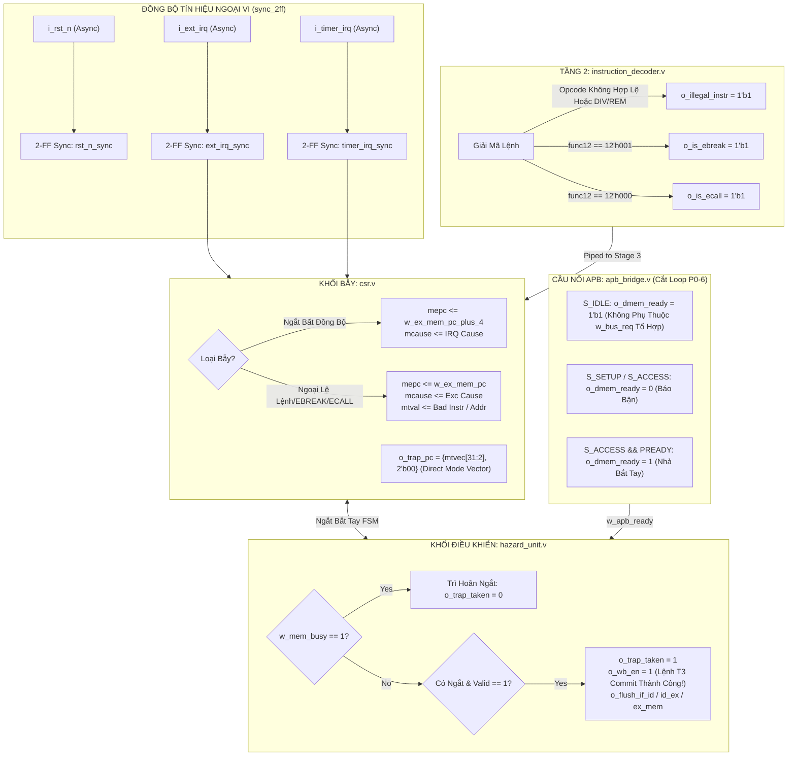

# Kế Hoạch Triển Khai Chi Tiết - Giai Đoạn 6 (PHASE 6)
## Khắc Phục Lỗi Ngắt/Bẫy (Interrupt/Trap), Triệt Tiêu Vòng Lặp APB, Bổ Sung Ngoại Lệ & Chuẩn Hóa RTL (RTL Hygiene)

**Dự án:** RISC-V 32-bit IoT & AI Accelerator Core (`riscv_core_top`)  
**Giai đoạn:** Phase 6 (Triển khai Bước 3 & Bước 4 trong lộ trình đóng kín tính đúng đắn vi kiến trúc)  
**Mục tiêu chính:** Khắc phục triệt để các lỗi phần cứng P0 còn lại (`P0-5`, `P0-6`, `P0-7`), hoàn thiện cơ chế bẫy ngoại lệ chuẩn RISC-V, triệt tiêu vòng lặp tổ hợp lưỡng ổn với cầu APB, và chuẩn hóa toàn diện mã nguồn RTL đạt chuẩn lint công nghiệp không cảnh báo.

---

## 1. Bối Cảnh & Mục Tiêu Của Phase 6

### 1.1. Bối Cảnh Kỹ Thuật Sau Phase 5
Sau khi Phase 5 hoàn thành xuất sắc việc khắc phục 4 lỗi Datapath & Forwarding (`P0-1` đến `P0-4`) với 100% testbench PASS, lõi CPU đã có đường dữ liệu đọc/ghi CSR và chuyển tiếp kết quả hoàn chỉnh. Tuy nhiên, tầng điều khiển bẫy (Traps), xử lý ngắt bất đồng bộ (Interrupts), giao tiếp bus APB và độ an toàn phần cứng vẫn còn các lỗ hổng nghiêm trọng đã được kiểm toán chỉ rõ:
1. **P0-5 (Mất lệnh Tầng 3 và hỏng `mepc` khi nhận ngắt bất đồng bộ):** Khi ngắt xảy ra, `hazard_unit.v` kéo `o_wb_en = 0` (hủy ghi trả Register File của lệnh Tầng 3), nhưng `csr.v` lại lưu `mepc = w_ex_mem_pc_plus_4` (PC của lệnh kế tiếp). Do đó lệnh tại Tầng 3 bị xóa vĩnh viễn và không bao giờ được thực thi lại sau `MRET`. Hơn nữa, `o_int_req` không kiểm tra `i_valid`, có thể nhận ngắt ngay trong chu kỳ bong bóng NOP và ghi đè `mepc = 0x0000_0000`.
2. **P0-6 (Vòng lặp tổ hợp lưỡng ổn giữa `hazard_unit` và `apb_bridge`):** Tín hiệu `w_hz_mem_en` (`~o_trap_taken`) khóa `i_bus_read` của `apb_bridge`; khối này lại điều khiển tổ hợp `o_dmem_ready`, truyền ngược về `w_mem_busy` và `o_trap_taken` (`i_int_req & ~w_mem_busy`), tạo thành vòng phản hồi tổ hợp không qua thanh ghi khiến `Makefile` phải dùng cờ `-Wno-UNOPTFLAT`.
3. **P0-7 (Lệnh chia `DIV/REM` âm thầm thực thi phép cộng `ADD`):** Do thiếu bộ giải mã và phần cứng chia, các opcode `DIV/DIVU/REM/REMU` rơi vào nhánh `default: o_alu_ctrl = ALU_ADD;` của `instruction_decoder.v`, tự động thực hiện phép cộng `rs1 + rs2` và ghi vào `rd` mà không bẫy lỗi.
4. **R-16 & R-17 (Thiếu bẫy `EBREAK`, lệnh bất hợp lệ, `mtval` và che bit mode `mtvec`):** `EBREAK` chạy như NOP; không có cơ chế bẫy `EXC_ILLEGAL_INST`; thanh ghi `mtval` không có nhánh ghi; `mtvec` nhảy trực tiếp mà không xóa 2 bit chế độ `mtvec[1:0]`.
5. **R-11 & R-12 (Vấn đề tổng hợp & độ tin cậy vật lý):** Include guard trong `riscv_core_defines.vh` đóng quá sớm ở dòng 20; `stage_if.v` dùng toán tử `===`; thiếu mạch đồng bộ 2-FF chống siêu ổn định trên các chân ngắt và reset ngoài; SRAM 2KB bị lặp bóng (aliasing) đè nát mã nguồn kernel khi tràn stack.

### 1.2. Mục Tiêu Cụ Thể Của Phase 6
- [ ] **Sửa P0-5**: Cho phép lệnh đang ở Tầng 3 hoàn tất chu kỳ ghi trả (`o_wb_en = 1`), lưu `mepc = w_ex_mem_pc_plus_4`, và chỉ chấp nhận ngắt khi Tầng 3 chứa lệnh hợp lệ (`w_ex_mem_valid == 1`).
- [ ] **Sửa P0-6**: Tách tín hiệu bắt tay `o_dmem_ready` trong `apb_bridge.v` thành tín hiệu dựa trên trạng thái FSM tuần tự, triệt tiêu hoàn toàn đường phản hồi tổ hợp với `hazard_unit.v`.
- [ ] **Sửa P0-7 & R-16**: Bổ sung bẫy lệnh bất hợp lệ (`mcause = 2`) cho `DIV/REM` và các opcode không hợp lệ; giải mã chuẩn lệnh `EBREAK` (`mcause = 3`).
- [ ] **Sửa R-17**: Thêm nhánh ghi cho `mtval` (`12'h343`), che 2 bit chế độ `mtvec[1:0]` khi nhảy bẫy (`o_trap_pc = {mtvec[31:2], 2'b00}`).
- [ ] **Sửa R-11 & R-12**: Sửa include guard trong `riscv_core_defines.vh`, thay toán tử `===`, thêm mạch đồng bộ 2-FF (`sync_2ff.v`) cho `i_rst_n`, `i_ext_irq`, `i_timer_irq`, và kiểm tra biên địa chỉ SRAM 2KB.
- [ ] **Xóa bỏ cờ `-Wno-UNOPTFLAT`**: `make lint` (Verilator 5.024) chạy sạch sẽ 0 error, 0 warning.
- [ ] **Kiểm chứng hoàn chỉnh**: Xây dựng testbench tự kiểm tra `tb/tb_phase6_control_traps.v` kiểm thử 100% các tính năng trên và chạy hồi quy toàn bộ hệ thống testbench cũ.

---

## 2. Thiết Kế Chi Tiết & Giải Pháp Kỹ Thuật (Detailed Technical Design)



---

### 2.1. Chi Tiết Sửa Lỗi P0-5 (Cơ Chế Commit Khi Có Ngắt & mepc)

#### Nguyên nhân kỹ thuật:
Trong `hazard_unit.v` dòng 127:
```verilog
assign o_wb_en = (~w_mem_busy) & (~o_trap_taken);
```
Khi có ngắt, `o_trap_taken = 1`, dẫn tới `o_wb_en = 0` (hủy bỏ lệnh ghi trả của lệnh tại Tầng 3). Trong khi đó, `csr.v` dòng 129 lại lưu:
```verilog
mepc <= i_next_commit_pc; // w_ex_mem_pc_plus_4
```
Lệnh tại Tầng 3 bị hủy nhưng `mepc` lại lưu địa chỉ của lệnh kế tiếp, khiến lệnh Tầng 3 bị nuốt mất vĩnh viễn. Ngoài ra, `o_int_req` trong `csr.v` không kiểm tra `i_valid`, có thể nhận ngắt khi Tầng 3 đang là bong bóng rác (`valid == 0`).

#### Giải pháp hiện thực:
1. **Quy tắc commit kiến trúc**: Chọn phương án **Lệnh Tầng 3 hoàn tất commit**:
   - Khi có ngắt bất đồng bộ và `~w_mem_busy`, giữ nguyên `o_wb_en = ~w_mem_busy` để lệnh Tầng 3 kịp hoàn tất ghi trả vào Register File hoặc SRAM.
   - Khi đó, việc lưu `mepc <= w_ex_mem_pc_plus_4` là hoàn toàn chính xác theo chuẩn RISC-V Privileged Architecture (sau khi `MRET`, CPU thực thi tiếp lệnh kế tiếp).
   - Đối với **ngoại lệ đồng bộ (Exception: ECALL, EBREAK, Illegal Instruction, Bus Error)**: Lệnh gây lỗi không được commit (`o_wb_en = 0`), và `mepc <= w_ex_mem_pc` (địa chỉ của chính lệnh gây lỗi).
2. **Khóa ngắt khi gặp bong bóng đường ống**:
   - Trong `csr.v`: Chỉ sinh yêu cầu ngắt có hiệu lực khi Tầng 3 có lệnh hợp lệ (`i_valid == 1`):
     ```verilog
     assign o_int_req = (w_is_ext_irq | w_is_tmr_irq) & i_valid;
     ```
   - Điều này đảm bảo `mepc` luôn lưu giá trị PC hợp lệ, không bao giờ bị gán `0x0000_0000`.

---

### 2.2. Chi Tiết Sửa Lỗi P0-6 (Triệt Tiêu Vòng Lặp Tổ Hợp APB $\leftrightarrow$ Hazard)

#### Nguyên nhân kỹ thuật:
Tại `apb_bridge.v` dòng 80:
```verilog
assign o_dmem_ready = (r_state == S_IDLE && !w_bus_req) || (r_state == S_ACCESS && i_apb_pready);
```
Trong `S_IDLE`, `o_dmem_ready` phụ thuộc trực tiếp vào `!w_bus_req`. Mà `w_bus_req` nhận tín hiệu `w_hz_mem_en` (`~o_trap_taken`). Khi có ngắt, `o_trap_taken` lại phụ thuộc vào `~w_mem_busy`, vốn phụ thuộc ngược lại `o_dmem_ready`. Đây là vòng lặp tổ hợp lưỡng ổn không qua thanh ghi.

#### Giải pháp hiện thực:
Trong [`rtl/bus/apb_bridge.v`](file:///home/ngobinh/RISCV_IOT_AIACCELATOR/rtl/bus/apb_bridge.v):
1. Tách logic sẵn sàng của bus:
   - Ở trạng thái `S_IDLE`, bus luôn sẵn sàng đón nhận giao dịch mới: `o_dmem_ready = 1'b1` (không phụ thuộc vào `w_bus_req` tổ hợp).
   - Khi có yêu cầu truy cập bus (`w_bus_req == 1`), FSM chuyển sang `S_SETUP` ở sườn đồng hồ kế tiếp.
   - Ở trạng thái `S_SETUP` và `S_ACCESS` (khi `~i_apb_pready`), `o_dmem_ready = 1'b0` (báo bận, ép CPU stall đợi).
   - Ở chu kỳ `S_ACCESS` cuối cùng khi ngoại vi phản hồi (`i_apb_pready == 1`), `o_dmem_ready = 1'b1` (nhả stall).
2. Công thức gán mới:
   ```verilog
   assign o_dmem_ready = (r_state == S_IDLE) || (r_state == S_ACCESS && i_apb_pready);
   ```
3. Cắt đứt hoàn toàn đường truyền tổ hợp `w_hz_mem_en` $\rightarrow$ `o_dmem_ready` $\rightarrow$ `w_mem_busy` $\rightarrow$ `o_trap_taken`.
4. Sau khi sửa, xóa bỏ cờ `-Wno-UNOPTFLAT` khỏi `Makefile`.

---

### 2.3. Chi Tiết Sửa Lỗi P0-7, R-16 & R-17 (Bẫy Lệnh Bất Hợp Lệ, EBREAK, `mtval`)

#### Giải pháp hiện thực:
1. **Trong [`rtl/core/instruction_decoder.v`](file:///home/ngobinh/RISCV_IOT_AIACCELATOR/rtl/core/instruction_decoder.v)**:
   - Thêm cổng xuất:
     ```verilog
     output reg o_illegal_instr,
     output reg o_is_ebreak
     ```
   - Nhánh `w_func7 == 7'b0000001` (M extension):
     ```verilog
     case (w_func3)
         3'b000: begin o_mul_valid = 1'b1; o_mul_type = 2'b00; end // MUL
         3'b001: begin o_mul_valid = 1'b1; o_mul_type = 2'b01; end // MULH
         3'b010: begin o_mul_valid = 1'b1; o_mul_type = 2'b10; end // MULHSU
         3'b011: begin o_mul_valid = 1'b1; o_mul_type = 2'b11; end // MULHU
         default: o_illegal_instr = 1'b1; // DIV/DIVU/REM/REMU -> Illegal Instruction Trap
     endcase
     ```
   - Nhánh `OP_SYSTEM`:
     ```verilog
     case (w_func12)
         12'b0000_0000_0000: o_is_ecall       = 1'b1; // ECALL
         12'b0000_0000_0001: o_is_ebreak      = 1'b1; // EBREAK
         12'b0011_0000_0010: o_is_mret        = 1'b1; // MRET
         12'b0001_0000_0101: o_sleep_req      = 1'b1; // WFI
         default:            o_illegal_instr  = 1'b1;
     endcase
     ```
   - Nhánh `default` của opcode: `default: o_illegal_instr = 1'b1;`.
2. **Dẫn truyền qua đường ống**:
   - Truyền `o_illegal_instr` và `o_is_ebreak` từ `stage_id_ex.v` $\rightarrow$ `pipe_reg_ex_mem.v` $\rightarrow$ `csr.v`.
3. **Trong [`rtl/core/csr.v`](file:///home/ngobinh/RISCV_IOT_AIACCELATOR/rtl/core/csr.v)**:
   - Thêm cổng đầu vào: `input wire i_illegal_instr`, `input wire i_is_ebreak`, `input wire [31:0] i_instr`.
   - Sinh ngoại lệ đồng bộ:
     ```verilog
     assign o_exc_req = (i_is_ecall | i_is_ebreak | i_illegal_instr | i_bus_error) & i_valid;
     ```
   - Mã nguyên nhân ngoại lệ `mcause`:
     - `i_illegal_instr`: `mcause <= 32'd2; mtval <= i_instr;` (Lưu mã lệnh lỗi vào mtval).
     - `i_is_ebreak`: `mcause <= 32'd3; mtval <= i_pc;`
     - `i_is_ecall`: `mcause <= 32'd11; mtval <= 32'd0;`
     - `i_bus_error`: `mcause <= (i_mem_write ? 32'd7 : 32'd5); mtval <= i_alu_result;`
   - Bổ sung nhánh ghi cho `mtval`:
     ```verilog
     12'h343: mtval <= w_next_csr_data;
     ```
   - Mặt nạ che bit chế độ `mtvec`:
     ```verilog
     assign o_csr_pc = {mtvec[31:2], 2'b00};
     ```

---

### 2.4. Chi Tiết Chuẩn Hóa RTL, Lint & Độ Tin Cậy Vật Lý (R-11, R-12)

1. **Header Guard trong [`riscv_core_defines.vh`](file:///home/ngobinh/RISCV_IOT_AIACCELATOR/rtl/defines/riscv_core_defines.vh)**:
   - Di chuyển dòng `` `endif // RISCV_FIELD_DEFINES_VH `` từ dòng 20 xuống cuối cùng của tệp (sau dòng 125).
2. **Loại bỏ toán tử 4 trạng thái trong [`stage_if.v`](file:///home/ngobinh/RISCV_IOT_AIACCELATOR/rtl/core/stage_if.v)**:
   - Thay thế mọi `=== 2'b11` và `=== OP_JAL` thành `== 2'b11` và `== OP_JAL`.
3. **Mạch đồng bộ 2-FF chống siêu ổn định**:
   - Tạo module tái sử dụng [`rtl/core/sync_2ff.v`](file:///home/ngobinh/RISCV_IOT_AIACCELATOR/rtl/core/sync_2ff.v):
     ```verilog
     module sync_2ff #(parameter WIDTH = 1, parameter RST_VAL = 0) (
         input  wire             i_clk,
         input  wire             i_rst_n,
         input  wire [WIDTH-1:0] i_async,
         output wire [WIDTH-1:0] o_sync
     );
         reg [WIDTH-1:0] r_meta;
         reg [WIDTH-1:0] r_sync;
         always @(posedge i_clk or negedge i_rst_n) begin
             if (!i_rst_n) begin
                 r_meta <= {WIDTH{RST_VAL[0]}};
                 r_sync <= {WIDTH{RST_VAL[0]}};
             end else begin
                 r_meta <= i_async;
                 r_sync <= r_meta;
             end
         end
         assign o_sync = r_sync;
     endmodule
     ```
   - Áp dụng vào `core_top.v` cho `i_ext_irq` và `i_timer_irq`.
4. **Kiểm tra biên địa chỉ SRAM 2KB**:
   - Trong `core_top.v`: Khi địa chỉ truy cập không thuộc MMIO (`addr[31:24] != 8'h40`) và `addr[31:11] != 21'd0` (vượt ngoài 2KB), chặn kích hoạt SRAM và sinh cờ báo lỗi bộ nhớ kích hoạt trap `mcause = 5/7`.

---

## 3. Danh Mục Các Tệp Cần Chỉnh Sửa Trong Phase 6

| Tệp tin | Vị trí thay đổi | Mục đích thay đổi |
| :--- | :--- | :--- |
| [`rtl/defines/riscv_core_defines.vh`](file:///home/ngobinh/RISCV_IOT_AIACCELATOR/rtl/defines/riscv_core_defines.vh) | Dòng 20 $\rightarrow$ Cuối tệp | Sửa include guard bao bọc 100% header |
| [`rtl/bus/apb_bridge.v`](file:///home/ngobinh/RISCV_IOT_AIACCELATOR/rtl/bus/apb_bridge.v) | Dòng 80 | Triệt tiêu vòng lặp tổ hợp với `hazard_unit` (P0-6) |
| [`rtl/core/hazard_unit.v`](file:///home/ngobinh/RISCV_IOT_AIACCELATOR/rtl/core/hazard_unit.v) | Dòng 71, 127 | Cho phép lệnh T3 commit khi có ngắt, dọn `r_flush_id_ex` (P0-5) |
| [`rtl/core/csr.v`](file:///home/ngobinh/RISCV_IOT_AIACCELATOR/rtl/core/csr.v) | Dòng 99–150 | Khóa ngắt theo `i_valid`, bẫy `illegal_instr`, `ebreak`, ghi `mtval`, che bit `mtvec` (P0-5, P0-7, R-16, R-17) |
| [`rtl/core/instruction_decoder.v`](file:///home/ngobinh/RISCV_IOT_AIACCELATOR/rtl/core/instruction_decoder.v) | Dòng 113, 240–265 | Bẫy lệnh bất hợp lệ cho `DIV/REM`, giải mã `EBREAK` (P0-7, R-16) |
| [`rtl/core/stage_id_ex.v`](file:///home/ngobinh/RISCV_IOT_AIACCELATOR/rtl/core/stage_id_ex.v) | Ports & assignment | Dẫn cờ `illegal_instr`, `ebreak`, và mã lệnh `instr` ra Tầng 3 |
| [`rtl/core/pipe_reg_ex_mem.v`](file:///home/ngobinh/RISCV_IOT_AIACCELATOR/rtl/core/pipe_reg_ex_mem.v) | Ports & sequential | Chốt cờ `illegal_instr`, `ebreak`, và `instr` sang Tầng 3 |
| [`rtl/core/stage_if.v`](file:///home/ngobinh/RISCV_IOT_AIACCELATOR/rtl/core/stage_if.v) | Dòng 132, 133 | Thay toán tử `===` thành `==` chuẩn tổng hợp |
| [`rtl/core/sync_2ff.v`](file:///home/ngobinh/RISCV_IOT_AIACCELATOR/rtl/core/sync_2ff.v) | Tệp mới | Module đồng bộ 2-FF chống siêu ổn định cho chân ngắt/reset |
| [`rtl/core/core_top.v`](file:///home/ngobinh/RISCV_IOT_AIACCELATOR/rtl/core/core_top.v) | Instantiation & wires | Tích hợp `sync_2ff`, kiểm tra biên SRAM, kết nối cờ ngoại lệ |
| [`Makefile`](file:///home/ngobinh/RISCV_IOT_AIACCELATOR/Makefile) | Dòng 175 | Xóa bỏ cờ `-Wno-UNOPTFLAT` |

---

## 4. Kế Hoạch Kiểm Chứng & Xác Thực Của Phase 6 (Verification Plan)

### 4.1. Testbench Tự Kiểm Tra Mới: [`tb/tb_phase6_control_traps.v`](file:///home/ngobinh/RISCV_IOT_AIACCELATOR/tb/tb_phase6_control_traps.v)
Bao gồm các kịch bản kiểm thử có hướng tự kiểm tra:
1. **Testcase 1 (Bẫy Lệnh Bất Hợp Lệ DIV/REM P0-7)**:
   - Thực thi opcode `DIV x5, x6, x7` (`0x027342b3`).
   - Kiểm tra: CPU không chạy phép cộng `ADD`; bẫy thành công sang `mtvec`; xác nhận `mcause == 32'd2`, `mepc == PC_DIV`, `mtval == 0x027342b3`.
2. **Testcase 2 (Bẫy Breakpoint EBREAK R-16)**:
   - Thực thi lệnh `EBREAK` (`0x00100073`).
   - Kiểm tra: Bẫy thành công sang `mtvec`; `mcause == 32'd3`, `mepc == PC_EBREAK`.
3. **Testcase 3 (Ngắt Bất Đồng Bộ Bảo Toàn Lệnh Tầng 3 P0-5)**:
   - Cho CPU chạy chuỗi lệnh `SW` và `ADDI`.
   - Bơm xung `i_ext_irq = 1`.
   - Kiểm tra: Lệnh tại Tầng 3 hoàn tất commit (dữ liệu ghi vào RAM/RF chính xác); `mepc == PC_NEXT` (không làm mất lệnh); `mcause == 32'h8000000B`.
   - Thực thi `MRET`: CPU khôi phục luồng chạy bình thường.
4. **Testcase 4 (Không Nhận Ngắt Trong Bong Bóng NOP P0-5)**:
   - Bơm ngắt khi đường ống đang flush; xác nhận `mepc` không bị ghi đè bằng `0x0000_0000`.
5. **Testcase 5 (Ghi & Đọc `mtval` R-17)**:
   - Thực thi `csrw mtval, t0`; đọc lại xác nhận `mtval == t0`.
6. **Testcase 6 (Kiểm Chứng Triệt Tiêu Vòng Lặp APB P0-6)**:
   - Bơm ngắt trong khi CPU đang thực hiện truy cập MMIO APB có wait-state; xác nhận giao dịch bus hoàn tất đúng đắn và không bị treo hoặc dao động tổ hợp.

### 4.2. Kiểm Tra Lint Không Dùng `-Wno-UNOPTFLAT`
- Chạy `make lint` với Verilator 5.024.
- Mục tiêu: **0 errors, 0 warnings** (bao gồm việc phát hiện sạch hoàn toàn các lỗi vòng lặp tổ hợp).

### 4.3. Chạy Hồi Quy Toàn Hệ Thống (Regression Suite)
- Chạy toàn bộ 7 testbench (6 testbench cũ + `tb_phase5_datapath_p0.v`) đảm bảo 100% PASS (Zero Regression).

---

## 5. Tiêu Chí Hoàn Thành Phase 6 (Definition of Done)

1. [ ] Sửa xong toàn bộ các lỗi `P0-5`, `P0-6`, `P0-7`, `R-16`, `R-17`, `R-11`, `R-12`.
2. [ ] Tạo mới module `sync_2ff.v` và tích hợp sạch vào `core_top.v`.
3. [ ] Xóa bỏ hoàn toàn cờ `-Wno-UNOPTFLAT` khỏi `Makefile`; `make lint` đạt 0 error, 0 warning.
4. [ ] Testbench `tb/tb_phase6_control_traps.v` chạy trên QuestaSim đạt **PASS 100%**.
5. [ ] Toàn bộ 7 testbench hiện hữu chạy **PASS 100%** (Zero Regression).
6. [ ] Không chèn bất kỳ AI watermark hay chú thích tự động nào theo quy tắc `~/.agents/AGENTS.md`.
