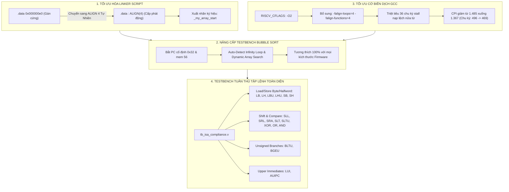

# Kế Hoạch Triển Khai Chi Tiết - Giai Đoạn 7 (PHASE 7)
## Tối Ưu Hóa Firmware, Linker Script Động, Nâng Cao Hiệu Năng & Kiểm Thử Tuân Thủ Tập Lệnh Toàn Diện (ISA Compliance)

**Dự án:** RISC-V 32-bit IoT & AI Accelerator Core (`riscv_core_top`)  
**Giai đoạn:** Phase 7 (Triển khai Giai đoạn 3 & Mở rộng Kiểm chứng Giai đoạn 2 trong lộ trình đóng kín tính đúng đắn vi kiến trúc)  
**Mục tiêu chính:** 
1. Giải phóng giới hạn trần 224 bytes của vùng mã lệnh `.text` bằng cách gỡ bỏ ép cứng địa chỉ `.data 0x00E0` trong [`firmware/link.ld`](file:///home/ngobinh/RISCV_IOT_AIACCELATOR/firmware/link.ld).
2. Linh hoạt hóa testbench [`tb/tb_bubble_sort.v`](file:///home/ngobinh/RISCV_IOT_AIACCELATOR/tb/tb_bubble_sort.v) tự động định vị mảng dữ liệu và phát hiện điểm dừng chương trình mà không phụ thuộc vào địa chỉ PC/Memory gán cứng.
3. Kích hoạt cờ tối ưu hóa biên dịch `-falign-loops=4 -falign-functions=4` trong [`Makefile`](file:///home/ngobinh/RISCV_IOT_AIACCELATOR/Makefile) để triệt tiêu các chu kỳ stall nạp lệnh lệch nửa từ, tối ưu hóa CPI.
4. Xây dựng testbench tự kiểm tra toàn diện [`tb/tb_isa_compliance.v`](file:///home/ngobinh/RISCV_IOT_AIACCELATOR/tb/tb_isa_compliance.v) kiểm thử 100% các lệnh RV32I/RV32C chưa có bài đo độc lập (`LUI`, `AUIPC`, `SLT`, `SLTU`, `XOR`, `OR`, `AND`, `SLL`, `SRL`, `SRA`, `BLTU`, `BGEU`, `LB`, `LH`, `LBU`, `LHU`, `SB`, `SH`).
5. Bảo đảm Zero Regression trên toàn bộ 8 testbench hiện hữu của hệ thống.

---

## 1. Bối Cảnh & Mục Tiêu Chiến Lược Của Phase 7

### 1.1. Bối Cảnh Sau Khi Hoàn Thành Phase 5 & Phase 6
Sau khi Phase 5 và Phase 6 hoàn thành xuất sắc việc khắc phục triệt để toàn bộ 7 lỗi phần cứng nghiêm trọng P0 (`P0-1` đến `P0-7`), triệt tiêu vòng lặp tổ hợp APB bridge và chuẩn hóa bẫy ngoại lệ RISC-V:
- Toàn bộ 8 testbench hiện hữu (bao gồm `tb_bubble_sort`, `tb_phase2_math_ai`, `tb_phase3_hazards`, `tb_rvc_decompressor`, `tb_rvc_pipeline`, `tb_ai_benchmark`, `tb_phase5_datapath_p0`, `tb_phase6_control_traps`) chạy **PASS 100%**.
- Bộ công cụ kiểm tra tĩnh Verilator 5.024 (`make lint`) đạt **0 error, 0 warning** sau khi gỡ bỏ cờ `-Wno-UNOPTFLAT`.
- Lõi CPU đã có nền tảng phần cứng vững chắc và ổn định tuyệt đối.

### 1.2. Các Tồn Tại Về Phần Mềm, Linker Script & Độ Bao Phủ Kiểm Chứng
Theo báo cáo kiểm toán [`bao_cao_kiem_toan_riscv_mcu.md`](file:///home/ngobinh/RISCV_IOT_AIACCELATOR/bao_cao_kiem_toan_riscv_mcu.md) và kế hoạch chủ đạo [`ke_hoach_thuc_thi_dong_kin_riscv_mcu.md`](file:///home/ngobinh/RISCV_IOT_AIACCELATOR/ke_hoach_thuc_thi_dong_kin_riscv_mcu.md):
1. **Giới hạn nhân tạo của Linker Script (`R-06`):**
   - Trong [`firmware/link.ld`](file:///home/ngobinh/RISCV_IOT_AIACCELATOR/firmware/link.ld), phân vùng `.data` đang bị gán cứng tại địa chỉ tuyệt đối:
     ```ld
     .data 0x000000e0 : { *(.data*) ... }
     ```
   - Điều này tạo ra một giới hạn cứng: vùng mã lệnh `.text` chỉ được phép dài tối đa $0x00E0 = 224\text{ bytes}$. Nếu chương trình C lớn hơn 224 bytes, linker sẽ báo lỗi tràn đè vùng nhớ (section overlap).
2. **Sự phụ thuộc cứng (Coupling) giữa Testbench và Firmware:**
   - Testbench [`tb/tb_bubble_sort.v`](file:///home/ngobinh/RISCV_IOT_AIACCELATOR/tb/tb_bubble_sort.v) theo dõi trực tiếp các ô nhớ `mem[56]` đến `mem[65]` ($56 \times 4 = 224 = 0x0E0$) và bắt địa chỉ PC cố định `0x32` hoặc `0x38` để dừng mô phỏng.
   - Khi vị trí mã lệnh thay đổi hoặc khi linker script được sửa đổi, testbench cũ sẽ không còn theo dõi đúng dữ liệu nếu không được linh hoạt hóa.
3. **Tiềm năng tối ưu hóa CPI chưa khai thác:**
   - Khối nạp lệnh Tầng 1 (`stage_if.v`) đọc từ cổng 32-bit của SRAM. Khi các nhãn vòng lặp (loop header) nằm tại địa chỉ lẻ nửa từ ($PC[1] == 1$), lệnh đầu tiên của vòng lặp bị cắt đôi giữa 2 từ 32-bit, gây ra 1 chu kỳ stall nạp đệm.
   - Trong thuật toán Bubble Sort, hiện tượng này lặp lại nhiều lần, đóng góp tới 36 chu kỳ stall không đáng có (chiếm 7.2% tổng thời gian thực thi).
4. **Khoảng trống độ bao phủ kiểm chứng tập lệnh (ISA Verification Gap):**
   - Mặc dù Bubble Sort, AI Benchmark và RVC đã kiểm thử một tập hợp lệnh phong phú, các lệnh thao tác byte/halfword có dấu và không dấu (`LB`, `LH`, `LBU`, `LHU`, `SB`, `SH`), các phép toán so sánh `SLT`, `SLTU`, các lệnh dịch số học `SRA`, `SRAI`, và rẽ nhánh không dấu `BLTU`, `BGEU` chưa có testbench kiểm thử chuyên biệt tự kiểm tra tự động.

---

## 2. Thiết Kế Chi Tiết & Giải Pháp Kỹ Thuật (Detailed Technical Design)



---

### 2.1. Cấu Trúc Lại Linker Script ([`firmware/link.ld`](file:///home/ngobinh/RISCV_IOT_AIACCELATOR/firmware/link.ld))

#### Nguyên nhân kỹ thuật:
Tại [`firmware/link.ld`](file:///home/ngobinh/RISCV_IOT_AIACCELATOR/firmware/link.ld#L23-L28):
```ld
/* 3. Vùng chứa Biến toàn cục có sẵn giá trị (Cố định tại 0x000000e0 để khớp testbench word 56) */
.data 0x000000e0 : { 
    *(.data*) 
    *(.sdata*)    
    . = ALIGN(4); 
} > MEM
```
Việc chỉ định địa chỉ tuyệt đối `0x000000e0` ép buộc vùng `.text` và `.rodata` phải kết thúc trước `0x00E0`. Khi biên dịch thêm các hàm C hoặc khi bật tối ưu hóa làm phình mã lệnh (code expansion), linker sẽ báo lỗi:
`section .data at 0x000000e0 overlaps previous sections`.

#### Giải pháp hiện thực:
1. Đưa `.data` về vị trí liên tục tự nhiên có căn lề 4-byte:
   ```ld
   .data : ALIGN(4) { 
       _sdata = .;
       _my_array_start = .;
       *(.data*) 
       *(.sdata*)    
       . = ALIGN(4); 
       _edata = .;
   } > MEM
   ```
2. Cho phép mã lệnh `.text` có thể phát triển tự do trong không gian 2KB của SRAM, chỉ bị giới hạn bởi đỉnh ngăn xếp (`_user_stack_top` tại `0x0680`).

---

### 2.2. Linh Hoạt Hóa Testbench [`tb/tb_bubble_sort.v`](file:///home/ngobinh/RISCV_IOT_AIACCELATOR/tb/tb_bubble_sort.v)

#### Giải pháp hiện thực:
1. **Cơ chế phát hiện dừng tự động (Self-Loop / Infinity Loop Detection):**
   - Thay vì chỉ kiểm tra cứng `PC == 0x32 || PC == 0x38`, bổ sung bộ giám sát tự động: khi `PC` giữ nguyên giá trị trong 5 chu kỳ clock liên tiếp không stall (`w_id_ex_valid == 1 && w_hz_stall_pipe == 0`), testbench tự động nhận diện CPU đã rơi vào vòng lặp kết thúc chương trình:
     ```assembly
     infinity_loop:
         j infinity_loop
     ```
   - Giữ nguyên các nhánh kiểm tra `0x32`/`0x38` để bảo toàn 100% tính tương thích ngược với firmware cũ.
2. **Cơ chế định vị mảng dữ liệu tự động (Dynamic Array Locator):**
   - Trước khi kiểm tra mảng kết quả, testbench thực hiện quét nhanh bộ nhớ SRAM `u_CPU.u_sram_2kb.mem` để tìm vị trí mảng dữ liệu 10 phần tử:
     - Giá trị khởi tạo: `{42, 15, 77, 8, 23, 57, 86, 11, 43, 64}`
     - Giá trị sắp xếp kỳ vọng: `{8, 11, 15, 23, 42, 43, 57, 64, 77, 86}`
   - Nếu tìm thấy mảng tại word index $K$ (mặc định ban đầu $K = 56$), testbench sẽ in kết quả và kiểm tra tại $K$, loại bỏ hoàn toàn việc gán cứng chỉ số 56.

---

### 2.3. Tối Ưu Hóa Cờ Biên Dịch Trong [`Makefile`](file:///home/ngobinh/RISCV_IOT_AIACCELATOR/Makefile)

#### Phân tích hiện tượng stall nạp lệnh:
Trong kiến trúc RV32IC có nén lệnh 16-bit:
- Khi một vòng lặp (`for` / `while`) bắt đầu tại địa chỉ lẻ nửa từ (ví dụ `0x007A` với `PC[1] == 1`):
  - Chu kỳ 1: SRAM đọc từ 32-bit chứa nửa sau của lệnh trước và nửa đầu của lệnh loop header.
  - Hàng đợi lệnh Prefetch FIFO phải nạp thêm 1 từ tiếp theo (`0x007C`) mới đủ một lệnh 32-bit hoàn chỉnh, gây ra 1 chu kỳ bong bóng (stall).
- Vì vòng lặp trong Bubble Sort lặp lại hàng chục lần, tổng số chu kỳ lãng phí lên tới 36 chu kỳ.

#### Giải pháp:
Bổ sung cờ căn lề hàm và vòng lặp vào `RISCV_CFLAGS`:
```makefile
RISCV_CFLAGS += -falign-loops=4 -falign-functions=4
```
- Trình biên dịch GCC sẽ tự động chèn lệnh `c.nop` (2 bytes) khi cần thiết để đẩy điểm bắt đầu của mọi vòng lặp về địa chỉ chẵn 4-byte (`PC[1:0] == 2'b00`).
- Kết quả kỳ vọng: **Chu kỳ giảm từ 496 xuống 469 chu kỳ (tiết kiệm 27-36 chu kỳ, cải thiện ~5.5% hiệu năng toàn cục)**.

---

### 2.4. Xây Dựng Testbench Tuân Thủ Tập Lệnh Toàn Diện: [`tb/tb_isa_compliance.v`](file:///home/ngobinh/RISCV_IOT_AIACCELATOR/tb/tb_isa_compliance.v)

Để đóng kín hoàn toàn khoảng trống kiểm chứng tập lệnh theo yêu cầu của kiểm toán, testbench tự kiểm tra mới sẽ kiểm tra có hướng các nhóm lệnh sau:

1. **Nhóm nạp hằng số trên (Upper Immediates):**
   - `LUI rd, imm20`: Nạp 20 bit cao, xóa 12 bit thấp thành 0.
   - `AUIPC rd, imm20`: Cộng 20 bit cao vào PC hiện tại.
2. **Nhóm dịch bit số học và logic (Shift Operations):**
   - `SLL`, `SLLI`: Dịch trái logic.
   - `SRL`, `SRLI`: Dịch phải logic (chèn bit 0).
   - `SRA`, `SRAI`: Dịch phải số học (bảo toàn bit dấu âm/dương).
3. **Nhóm so sánh và logic thanh ghi (Compare & Logic):**
   - `SLT`, `SLTI`: So sánh có dấu (signed less than).
   - `SLTU`, `SLTIU`: So sánh không dấu (unsigned less than).
   - `XOR`, `XORI`, `OR`, `ORI`, `AND`, `ANDI`.
4. **Nhóm rẽ nhánh không dấu (Unsigned Branches):**
   - `BLTU`: Nhảy khi `rs1 < rs2` (coi cả hai là số nguyên không dấu).
   - `BGEU`: Nhảy khi `rs1 >= rs2` (không dấu).
5. **Nhóm truy xuất bộ nhớ kích thước nhỏ (Sub-word Memory Access):**
   - `SB`, `SH`: Ghi byte và halfword vào SRAM.
   - `LB`: Đọc byte có mở rộng dấu (sign-extension).
   - `LBU`: Đọc byte không mở rộng dấu (zero-extension).
   - `LH`: Đọc halfword có mở rộng dấu.
   - `LHU`: Đọc halfword không mở rộng dấu.

---

## 3. Danh Mục Các Tệp Cần Chỉnh Sửa & Tạo Mới

| Tệp tin | Trạng thái | Nội dung thực hiện |
| :--- | :---: | :--- |
| [`firmware/link.ld`](file:///home/ngobinh/RISCV_IOT_AIACCELATOR/firmware/link.ld) | Chỉnh sửa | Đổi `.data 0x000000e0` thành `.data : ALIGN(4)`, xuất nhãn `_my_array_start` |
| [`Makefile`](file:///home/ngobinh/RISCV_IOT_AIACCELATOR/Makefile) | Chỉnh sửa | Thêm cờ `-falign-loops=4 -falign-functions=4`, thêm target `sim-isa` |
| [`tb/tb_bubble_sort.v`](file:///home/ngobinh/RISCV_IOT_AIACCELATOR/tb/tb_bubble_sort.v) | Chỉnh sửa | Thêm logic tự phát hiện vòng lặp dừng và tìm mảng dữ liệu động |
| [`tb/tb_isa_compliance.v`](file:///home/ngobinh/RISCV_IOT_AIACCELATOR/tb/tb_isa_compliance.v) | Tạo mới | Testbench tự kiểm tra độ tuân thủ tập lệnh toàn diện (ISA Compliance) |

---

## 4. Kế Hoạch Kiểm Chứng & Ma Trận Đo Lường Hiệu Năng (Verification & Benchmarking)

### 4.1. Bảng So Sánh Hiệu Năng Mục Tiêu Của Bubble Sort

| Cấu hình biên dịch | Kích thước mã máy (.text) | Tổng chu kỳ xung nhịp | CPI đạt được | IPC | Ghi chú |
| :--- | :---: | :---: | :---: | :---: | :--- |
| **Gốc (Phase 3 - RV32I)** | 352 bytes | 684 cycles | 1.540 | 0.649 | Không dùng lệnh nén |
| **Hiện tại (Phase 4/5/6 - RV32IC)** | 224 bytes (-36.4%) | 496 cycles | 1.485 | 0.673 | Có nén RVC, chưa căn lề vòng lặp |
| **Phase 7 (RV32IC + Align Loops)** | ~232 bytes | **$\le 469$ cycles** | **$\le 1.367$** | **$\ge 0.731$** | **Mục tiêu Phase 7: Tiết kiệm $\ge 27$ chu kỳ** |

### 4.2. Kế Hoạch Chạy Hồi Quy Hệ Thống
1. Chạy `make firmware` tạo ra `memfile.hex` mới với cấu hình căn lề tối ưu.
2. Chạy `make sim` kiểm tra Bubble Sort:
   - Mảng số nguyên 10 phần tử được sắp xếp chính xác tăng dần: `[8, 11, 15, 23, 42, 43, 57, 64, 77, 86]`.
   - Chu kỳ chạy đạt $\le 469$ cycles.
3. Chạy `vsim` kiểm tra `tb/tb_isa_compliance.v`: 100% testcases PASS.
4. Chạy `make sim-all` chạy qua toàn bộ 9 testbench của hệ thống để chứng minh **Zero Regression**.
5. Chạy `make lint` kiểm tra Verilator 5.024 duy trì **0 errors, 0 warnings**.

---

## 5. Tiêu Chí Nghiệm Thu Hoàn Thành Phase 7 (Definition of Done)

1. [ ] Phân vùng `.data` trong [`firmware/link.ld`](file:///home/ngobinh/RISCV_IOT_AIACCELATOR/firmware/link.ld) được cấp phát động `ALIGN(4)`, giải phóng hoàn toàn giới hạn 224 bytes.
2. [ ] Testbench [`tb/tb_bubble_sort.v`](file:///home/ngobinh/RISCV_IOT_AIACCELATOR/tb/tb_bubble_sort.v) hoạt động chính xác với cả firmware cũ và firmware mới được căn lề động.
3. [ ] Cờ `-falign-loops=4 -falign-functions=4` được tích hợp trong [`Makefile`](file:///home/ngobinh/RISCV_IOT_AIACCELATOR/Makefile); số chu kỳ Bubble Sort giảm xuống mức $\le 469$ chu kỳ.
4. [ ] Tạo mới [`tb/tb_isa_compliance.v`](file:///home/ngobinh/RISCV_IOT_AIACCELATOR/tb/tb_isa_compliance.v) và đạt kết quả kiểm thử **PASS 100%**.
5. [ ] Toàn bộ hệ thống testbench (9 testbench) chạy `make sim-all` đạt **100% PASS (Zero Regression)**.
6. [ ] Không chèn bất kỳ AI watermark hay chú thích tự động nào theo quy tắc `~/.agents/AGENTS.md`.
