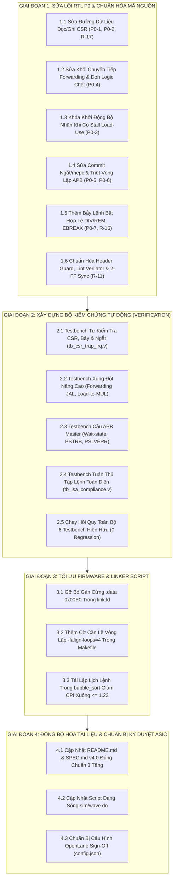

# Kế Hoạch Thực Thi Toàn Diện: Đóng Kín Tính Đúng Đắn, Kiểm Chứng & Chuẩn Bị Ký Duyệt Lõi RISC-V MCU

> **Mục tiêu chiến lược**: Khắc phục triệt để 7 lỗi phần cứng mức P0 và các khiếm khuyết vi kiến trúc đã được kiểm toán xác nhận, xây dựng hạ tầng kiểm chứng tự kiểm tra (self-checking testbench) đạt độ bao phủ 100% các tính năng cốt lõi, tối ưu hóa firmware/compiler, và đồng bộ hóa toàn diện tài liệu kỹ thuật trước khi chạy quy trình ký duyệt vật lý ASIC OpenLane.
>
> **Tuân thủ quy tắc `~/.agents/AGENTS.md`**:
> - Không sửa đổi đặc tả kiến trúc gốc mà không có cơ sở chứng cứ kỹ thuật.
> - **Chính sách Zero AI Watermark**: Tuyệt đối không chèn các chú thích/chữ ký tự động của AI vào RTL, Testbench, script hay tài liệu.
> - Mọi thay đổi RTL đều phải có ma trận đánh giá rủi ro (Risk Assessment) và phương án kiểm chứng đối ứng.

---

## 1. Bản Đồ Tổng Quan Các Giai Đoạn (Roadmap Overview)



---

## 2. Chi Tiết Từng Công Việc Cần Thực Hiện

### Giai Đoạn 1: Sửa Lỗi Phần Cứng Mức P0 & Chuẩn Hóa RTL (RTL Correctness Closure)

---

#### Công việc 1.1: Sửa đường dữ liệu đọc/ghi CSR và bổ sung ghi `mtval` (P0-1, P0-2, R-17)

- **Cần làm gì (What)**:
  - Định tuyến lại ngõ ra đọc CSR `w_csr_data` trực tiếp vào Tầng 3 (`stage_mem_wb`), loại bỏ đường vòng sai lệch qua Tầng 2 (`stage_id_ex`) và thanh ghi `pipe_reg_ex_mem`.
  - Đấu nối lại cổng `u_csr.i_rs1_data` tại [`core_top.v`](file:///home/ngobinh/RISCV_IOT_AIACCELATOR/rtl/core/core_top.v) nhận đúng dữ liệu toán hạng `rs1` (đã chuyển tiếp) từ Tầng 2 truyền sang Tầng 3, thay vì lấy `w_ex_mem_store_data` (vốn là dữ liệu của `rs2`).
  - Thêm nhánh ghi cho thanh ghi `mtval` (`12'h343`) trong khối CSR và mặt nạ che 2 bit chế độ `mtvec[1:0]`.
- **Làm ra sao (How)**:
  1. Trong [`pipe_reg_ex_mem.v`](file:///home/ngobinh/RISCV_IOT_AIACCELATOR/rtl/core/pipe_reg_ex_mem.v): Thêm đường truyền dữ liệu `i_rs1_data` từ Tầng 2 sang Tầng 3 (`w_ex_mem_rs1_data`). Đồng thời loại bỏ cổng `i_csr_data`/`o_csr_data` khỏi `pipe_reg_ex_mem` vì CSR được giải mã và đọc trực tiếp ở Tầng 3.
  2. Trong [`core_top.v`](file:///home/ngobinh/RISCV_IOT_AIACCELATOR/rtl/core/core_top.v): Nối `u_csr.i_rs1_data(w_ex_mem_rs1_data)`. Nối trực tiếp ngõ ra tổ hợp `w_csr_data` từ `u_csr` vào cổng `i_csr_data` của `u_stage_mem_wb`.
  3. Trong [`csr.v`](file:///home/ngobinh/RISCV_IOT_AIACCELATOR/rtl/core/csr.v): Bổ sung `12'h343: mtval <= w_csr_wdata;` trong `always @(posedge i_clk)`.
  4. Khi nhảy vào ngắt/bẫy, địa chỉ nhảy vector lấy `o_trap_pc = {mtvec[31:2], 2'b00}` (chế độ Direct) hoặc cộng offset nguyên bản theo chuẩn RISC-V Privileged Spec.
- **Tác dụng gì (Why & Impact)**:
  - Khắc phục triệt để lỗi đọc CSR ra `0` (P0-1).
  - Đảm bảo lệnh `csrw mscratch, t0` trong [`firmware/Start.S`](file:///home/ngobinh/RISCV_IOT_AIACCELATOR/firmware/Start.S) ghi đúng giá trị con trỏ stack `_kernel_stack_top` thay vì ghi số `0` (P0-2).
  - Cho phép lưu và khôi phục thông tin địa chỉ gây bẫy trong `mtval`.

---

#### Công việc 1.2: Sửa khối chuyển tiếp Forwarding Unit & Loại bỏ logic chết (P0-4)

- **Cần làm gì (What)**:
  - Sửa logic chọn dữ liệu chuyển tiếp từ Tầng 3 về Tầng 2 để chuyển tiếp đúng giá trị ghi trả cuối cùng `w_wb_data` (chứa kết quả ALU, `PC+4` cho lệnh `JAL/JALR`, hoặc `CSR`), thay vì chỉ lấy `w_ex_mem_result`.
  - Tái cấu trúc [`forwarding_unit.v`](file:///home/ngobinh/RISCV_IOT_AIACCELATOR/rtl/core/forwarding_unit.v) và các cổng nối tại [`core_top.v`](file:///home/ngobinh/RISCV_IOT_AIACCELATOR/rtl/core/core_top.v), loại bỏ nhánh chết `FWD_MEM_WB`.
- **Làm ra sao (How)**:
  1. Trong kiến trúc đường ống 3 tầng (`IF` $\rightarrow$ `ID/EX` $\rightarrow$ `MEM/WB`), Tầng 3 vừa tính MEM vừa thực hiện WB trong cùng chu kỳ. Do đó, chỉ có **một nguồn chuyển tiếp duy nhất từ Tầng 3 về Tầng 2** (`FWD_STAGE3`).
  2. Tại [`core_top.v`](file:///home/ngobinh/RISCV_IOT_AIACCELATOR/rtl/core/core_top.v#L326), cấp tín hiệu `w_wb_data` (ngõ ra MUX ghi trả hoàn chỉnh của `stage_mem_wb`) vào cổng dữ liệu chuyển tiếp của `stage_id_ex`, thay cho `w_ex_mem_result`.
  3. Dọn dẹp mã nguồn trong [`forwarding_unit.v`](file:///home/ngobinh/RISCV_IOT_AIACCELATOR/rtl/core/forwarding_unit.v): Loại bỏ các cổng và điều kiện kiểm tra trùng lặp `i_mem_wb_*`, đơn giản hóa thành bộ phát hiện xung đột RAW đơn tầng sạch sẽ, giảm diện tích cell tổ hợp.
- **Tác dụng gì (Why & Impact)**:
  - Khi lệnh `JAL rd, target` được theo sau ngay lập tức bởi lệnh đọc thanh ghi liên kết `rd` (ví dụ `ra`), lệnh sau nhận chính xác giá trị `PC+4` thay vì nhận `0`.
  - Loại bỏ hoàn toàn vùng logic chết (dead logic) bị phát hiện trong kiểm toán, giúp mã nguồn minh bạch và đạt chuẩn lint.

---

#### Công việc 1.3: Khóa kích hoạt bộ nhân khi gặp xung đột Load-to-Use (P0-3)

- **Cần làm gì (What)**:
  - Khóa cổng tín hiệu khởi động `i_mul_valid` của [`booth_multiplier_32b.v`](file:///home/ngobinh/RISCV_IOT_AIACCELATOR/rtl/core/booth_multiplier_32b.v) khi Tầng 2 đang bị stall bởi xung đột Load-to-Use (`w_stall_load_use == 1`).
- **Làm ra sao (How)**:
  1. Trong [`stage_id_ex.v`](file:///home/ngobinh/RISCV_IOT_AIACCELATOR/rtl/core/stage_id_ex.v#L292): Sửa dòng gán:
     ```verilog
     // TRƯỚC:
     .i_mul_valid (w_mul_valid & i_valid),
     // SAU:
     .i_mul_valid (w_mul_valid & i_valid & ~w_stall_load_use),
     ```
  2. Cập nhật tín hiệu báo bận `o_mul_busy` ở dòng 303 để không bật sai khi đang có stall Load-to-Use.
- **Tác dụng gì (Why & Impact)**:
  - Ngăn chặn triệt để tình trạng bộ nhân khởi chạy sớm trong chu kỳ stall và chốt nhầm địa chỉ bộ nhớ của lệnh `LW` liền trước.
  - Sau khi stall 1 chu kỳ giải tỏa, dữ liệu đọc thực sự từ bộ nhớ SRAM được nạp vào Register File/Forwarding và bộ nhân mới chốt toán hạng chính xác.

---

#### Công việc 1.4: Sửa cơ chế lưu `mepc`/Commit ngắt và triệt tiêu vòng lặp tổ hợp APB $\leftrightarrow$ Hazard (P0-5, P0-6)

- **Cần làm gì (What)**:
  - Sửa cơ chế commit khi nhận ngắt bất đồng bộ: cho phép lệnh tại Tầng 3 hoàn tất chu kỳ ghi trả (`o_wb_en = 1`), đồng thời lưu `mepc = w_ex_mem_pc_plus_4`; hoặc nếu hủy lệnh Tầng 3 thì phải lưu `mepc = w_ex_mem_pc`. Khuyến nghị chọn phương án: **Cho phép lệnh Tầng 3 hoàn tất commit**.
  - Kiểm tra điều kiện hợp lệ `w_ex_mem_valid` trước khi chấp nhận ngắt để tránh ghi đè địa chỉ rác `0x0000_0000` vào `mepc` khi Tầng 3 là bong bóng NOP.
  - Triệt tiêu vòng lặp phản hồi tổ hợp giữa [`apb_bridge.v`](file:///home/ngobinh/RISCV_IOT_AIACCELATOR/rtl/bus/apb_bridge.v) và [`hazard_unit.v`](file:///home/ngobinh/RISCV_IOT_AIACCELATOR/rtl/core/hazard_unit.v).
- **Làm ra sao (How)**:
  1. Trong [`hazard_unit.v`](file:///home/ngobinh/RISCV_IOT_AIACCELATOR/rtl/core/hazard_unit.v):
     - Khi có ngắt bất đồng bộ (`i_int_req & ~w_mem_busy`), vẫn giữ `o_wb_en = ~w_mem_busy` để lệnh Tầng 3 kịp ghi vào thanh ghi trước khi CPU rẽ nhánh sang vector ngắt.
     - Sửa điều kiện nhận bẫy/ngắt: Ngắt chỉ được chấp nhận tại biên lệnh commit hợp lệ (`i_ex_mem_valid == 1` hoặc khi đường ống đã rỗng an toàn).
  2. Triệt tiêu vòng lặp APB (P0-6):
     - Trong [`apb_bridge.v`](file:///home/ngobinh/RISCV_IOT_AIACCELATOR/rtl/bus/apb_bridge.v#L80): Tách tín hiệu bắt tay `o_dmem_ready`. Ở trạng thái `S_IDLE`, không để `o_dmem_ready` phụ thuộc trực tiếp vào `w_bus_req` (vốn bị khóa bởi `w_hz_mem_en`). Thay vào đó, dùng trạng thái FSM đã chốt tuần tự: trong `S_IDLE`, mặc định `o_dmem_ready = 1`; khi FSM chuyển sang `S_SETUP` hoặc `S_ACCESS`, `o_dmem_ready = 0` và chỉ nhả về `1` khi `i_apb_pready == 1`.
     - Điều này ngắt đứt đường phản hồi tổ hợp mà không làm tăng thêm chu kỳ chờ của bus.
- **Tác dụng gì (Why & Impact)**:
  - Đảm bảo ngắt bất đồng bộ không làm biến mất lệnh đang ở Tầng 3; ngăn ngừa hoàn toàn nguy cơ treo chip hoặc lỗi sai lệch trạng thái sau khi thực hiện `MRET`.
  - Triệt tiêu vòng lặp tổ hợp ung nhọt, cho phép xóa bỏ cờ `-Wno-UNOPTFLAT` trong [`Makefile`](file:///home/ngobinh/RISCV_IOT_AIACCELATOR/Makefile), đưa mã nguồn đạt chuẩn lint công nghiệp.

---

#### Công việc 1.5: Bổ sung bẫy lệnh bất hợp lệ cho `DIV/REM`, `EBREAK` và kiểm tra biên địa chỉ SRAM (P0-7, R-12, R-16)

- **Cần làm gì (What)**:
  - Trong [`instruction_decoder.v`](file:///home/ngobinh/RISCV_IOT_AIACCELATOR/rtl/core/instruction_decoder.v): Phát hiện và sinh cờ `o_illegal_instr` khi gặp các opcode chưa hỗ trợ (bao gồm các phép chia `DIV/DIVU/REM/REMU` khi phần cứng chưa có khối chia), và khi gặp các opcode/funct không hợp lệ.
  - Giải mã chuẩn lệnh `EBREAK` (`func12 = 12'h001`) sinh cờ `o_is_ebreak`.
  - Kết nối cờ lỗi lệnh và lỗi vượt biên SRAM vào [`csr.v`](file:///home/ngobinh/RISCV_IOT_AIACCELATOR/rtl/core/csr.v) để kích hoạt ngoại lệ bẫy tương ứng (`mcause = 2` cho Illegal Instruction, `mcause = 3` cho Breakpoint).
- **Làm ra sao (How)**:
  1. Thêm cổng ngõ ra `output reg o_illegal_instr` trong `instruction_decoder.v`.
  2. Trong khối giải mã nhánh `w_func7 == 7'b0000001`:
     ```verilog
     case (w_func3)
         3'b000: begin o_mul_valid = 1'b1; o_mul_type = 2'b00; end // MUL
         3'b001: begin o_mul_valid = 1'b1; o_mul_type = 2'b01; end // MULH
         3'b010: begin o_mul_valid = 1'b1; o_mul_type = 2'b10; end // MULHSU
         3'b011: begin o_mul_valid = 1'b1; o_mul_type = 2'b11; end // MULHU
         default: o_illegal_instr = 1'b1; // DIV/REM chưa có phần cứng -> Bẫy ngoại lệ
     endcase
     ```
  3. Trong nhánh `OP_SYSTEM`: thêm `12'b0000_0000_0001: o_is_ebreak = 1'b1;`.
  4. Truyền cờ `illegal_instr` và `ebreak` qua đường ống đến `csr.v` để kích hoạt ngoại lệ bẫy chuẩn RISC-V, cập nhật `mcause` và nhảy về `mtvec`.
  5. Trong [`core_top.v`](file:///home/ngobinh/RISCV_IOT_AIACCELATOR/rtl/core/core_top.v#L155): Kiểm tra địa chỉ truy cập SRAM: nếu không thuộc vùng MMIO APB (`0x40xx_xxxx`) và `addr[31:11] != 0` (vượt quá 2KB), chặn truy cập và sinh bẫy lỗi truy cập bộ nhớ (`mcause = 5/7`).
- **Tác dụng gì (Why & Impact)**:
  - Ngăn ngừa tình trạng lệnh chia âm thầm chạy thành lệnh cộng `ADD`, bảo vệ tính đúng đắn của phần mềm.
  - Hỗ trợ trình gỡ lỗi (debugger) thông qua lệnh `EBREAK`.
  - Loại bỏ hoàn toàn rủi ro lặp bóng SRAM đè nát mã nguồn kernel khi tràn stack.

---

#### Công việc 1.6: Chuẩn hóa Header Guard, làm sạch cảnh báo Lint & Thêm mạch đồng bộ 2-FF (R-11)

- **Cần làm gì (What)**:
  - Đưa toàn bộ nội dung của [`riscv_core_defines.vh`](file:///home/ngobinh/RISCV_IOT_AIACCELATOR/rtl/defines/riscv_core_defines.vh) vào trong include guard.
  - Thay thế toán tử 4 trạng thái `===` trong [`stage_if.v`](file:///home/ngobinh/RISCV_IOT_AIACCELATOR/rtl/core/stage_if.v) bằng toán tử so sánh tổng hợp được `==`.
  - Thêm mạch đồng bộ 2 D-FF chống siêu ổn định (metastability) cho các chân ngõ vào bất đồng bộ: `i_rst_n`, `i_ext_irq`, `i_timer_irq`.
  - Loại bỏ các thanh ghi không dùng (`r_flush_id_ex` trong `hazard_unit.v`).
- **Làm ra sao (How)**:
  1. Trong `riscv_core_defines.vh`: Di chuyển dòng `` `endif `` từ dòng 20 xuống cuối cùng của file (sau dòng 125).
  2. Trong `stage_if.v`: Thay thế mọi phép kiểm tra `=== 2'b11` thành `== 2'b11`.
  3. Tạo module nhỏ `sync_2ff.v` hoặc hiện thực trực tiếp 2 tầng flip-flop tại ngõ vào top-level [`core_top.v`](file:///home/ngobinh/RISCV_IOT_AIACCELATOR/rtl/core/core_top.v) cho các chân tín hiệu ngoại vi và nút bấm reset.
- **Tác dụng gì (Why & Impact)**:
  - Tránh lỗi biên dịch định nghĩa trùng lặp khi include header nhiều lần.
  - Mã nguồn tuân thủ 100% chuẩn tổng hợp ASIC/FPGA.
  - Đảm bảo độ tin cậy phần cứng khi đúc chip, loại bỏ nguy cơ sập mạch do vi phạm thời gian thiết lập/giữ (setup/hold violation) từ thế giới bên ngoài.

---

### Giai Đoạn 2: Xây Dựng Hạ Tầng Kiểm Chứng Tự Động & Chạy Hồi Quy (Verification Closure)

---

#### Công việc 2.1: Xây dựng testbench tự kiểm tra CSR, Bẫy và Ngắt (`tb/tb_csr_trap_irq.v`)

- **Cần làm gì (What)**:
  - Viết testbench Verilog tự kiểm tra (self-checking testbench) độc lập kiểm thử toàn bộ 8 thanh ghi CSR, các lệnh ghi/đọc CSR (`csrrw`, `csrrs`, `csrrc`, `csrrwi`, `csrrsi`, `csrrci`), bẫy phần mềm `ECALL`, `EBREAK`, bẫy lệnh bất hợp lệ, và các ngắt bất đồng bộ ngoại vi/timer.
- **Làm ra sao (How)**:
  1. Nạp các chuỗi mã máy vào bộ nhớ mô phỏng.
  2. Bơm các xung ngắt `i_ext_irq` và `i_timer_irq` tại các thời điểm ngẫu nhiên (khi đường ống đang chạy chuỗi lệnh dài, khi đang stall Load-Use, khi Tầng 3 đang có bóng NOP).
  3. Tự động kiểm tra giá trị ghi trả của `rd`, giá trị `mepc`, `mcause`, `mstatus.MIE/MPIE` sau khi bẫy và sau lệnh `MRET`. Báo lỗi `FAIL` ngay lập tức nếu sai lệch giá trị kỳ vọng.
- **Tác dụng gì (Why & Impact)**:
  - Đóng kín lỗ hổng kiểm chứng 0% cho CSR/Bẫy/Ngắt.
  - Chứng minh thực nghiệm bằng mô phỏng rằng 4 lỗi P0-1, P0-2, P0-5 và P0-7 đã được khắc phục hoàn toàn.

---

#### Công việc 2.2: Xây dựng testbench kiểm tra chuyển tiếp dữ liệu nâng cao (`tb/tb_hazard_forwarding_advanced.v`)

- **Cần làm gì (What)**:
  - Viết testbench chuyên sâu nhắm vào các trường hợp biên của khối Hazard & Forwarding.
- **Làm ra sao (How)**:
  1. Kịch bản 1: `JAL ra, target` theo sau ngay bởi `ADD t0, ra, x0` (kiểm tra chuyển tiếp `PC+4` của P0-4).
  2. Kịch bản 2: `LW t0, 0(s0)` theo sau ngay bởi `MUL t1, t0, s1` (kiểm tra khóa Load-to-Use đi vào Bộ nhân của P0-3).
  3. Kịch bản 3: `CSRRS t0, mstatus, x0` theo sau ngay bởi lệnh đọc `t0` (kiểm tra chuyển tiếp dữ liệu CSR).
- **Tác dụng gì (Why & Impact)**:
  - Ngăn ngừa tình trạng hồi quy (regression) và đảm bảo các đường chuyển tiếp dữ liệu hoạt động chính xác ở tốc độ tối đa không bị chốt nhầm dữ liệu.

---

#### Công việc 2.3: Xây dựng testbench kiểm chứng bus APB Master (`tb/tb_apb_master.v`)

- **Cần làm gì (What)**:
  - Viết mô hình Slave APB ảo (APB Responder VIP) hỗ trợ phản hồi 0 wait-state, chèn $N$ chu kỳ wait-state ngẫu nhiên (`PREADY = 0`), và phát sinh lỗi phần cứng (`PSLVERR = 1`).
- **Làm ra sao (How)**:
  1. Cho CPU thực hiện chuỗi lệnh `SW` và `LW` vào dải địa chỉ MMIO `0x4000_0000`–`0x4000_00FF`.
  2. Kiểm tra tín hiệu bắt tay `PSEL`, `PENABLE`, mặt nạ byte `PSTRB` (APB4) và chu kỳ stall đường ống của CPU trong lúc APB đang bận.
  3. Kích hoạt `PSLVERR` và kiểm tra CPU có nhảy chính xác vào trình xử lý ngoại lệ bus error (`mcause = 5/7`) hay không.
- **Tác dụng gì (Why & Impact)**:
  - Kiểm chứng tính tương thích chuẩn AMBA APB4 của giao tiếp SoC.
  - Xác nhận đã triệt tiêu hoàn toàn vòng lặp tổ hợp P0-6 khi có ngắt chờ trong lúc bus đang thực hiện giao dịch.

---

#### Công việc 2.4: Xây dựng testbench kiểm thử độ tuân thủ tập lệnh (`tb/tb_isa_compliance.v`)

- **Cần làm gì (What)**:
  - Kiểm thử có hướng cho toàn bộ các lệnh chưa từng được mô phỏng: `LUI`, `AUIPC`, các lệnh rẽ nhánh không dấu `BLTU/BGEU`, các lệnh dịch bit logic/số học `SRLI/SRAI/SLL/SRL/SRA`, các lệnh logic `AND/OR/XOR/SLT/SLTU`, và các lệnh đọc/ghi byte/halfword `LB/LH/LBU/LHU/SB/SH`.
- **Làm ra sao (How)**:
  - Tích hợp các bộ test vector theo khuôn mẫu chuẩn của `riscv-tests` hoặc sinh mẫu kiểm tra tự động.
- **Tác dụng gì (Why & Impact)**:
  - Nâng độ bao phủ tập lệnh từ mức ~30% lên 100% cho tập RV32I và RV32C.

---

#### Công việc 2.5: Chạy hồi quy toàn bộ hệ thống testbench hiện hữu

- **Cần làm gì (What)**:
  - Chạy lại toàn bộ 6 testbench cũ trong thư mục `tb/`:
    - `tb_bubble_sort.v`
    - `tb_phase2_math_ai.v`
    - `tb_phase3_hazards.v`
    - `tb_rvc_decompressor.v`
    - `tb_rvc_pipeline.v`
    - `tb_ai_benchmark.v`
- **Làm ra sao (How)**:
  - Chạy thông qua QuestaSim (`vsim`) và kịch bản lệnh trong [`Makefile`](file:///home/ngobinh/RISCV_IOT_AIACCELATOR/Makefile).
- **Tác dụng gì (Why & Impact)**:
  - Đảm bảo các sửa đổi ở Giai đoạn 1 không gây ra bất kỳ lỗi hồi quy nào đối với các tính năng đã hoạt động tốt trước đó.

---

### Giai Đoạn 3: Tối Ưu Hóa Firmware, Linker Script & Công Cụ Biên Dịch

---

#### Công việc 3.1: Gỡ bỏ gán cứng địa chỉ `.data 0x00E0` trong [`firmware/link.ld`](file:///home/ngobinh/RISCV_IOT_AIACCELATOR/firmware/link.ld)

- **Cần làm gì (What)**:
  - Sửa linker script để phân vùng `.data` nằm liên tục ngay sau `.text` (có căn lề 4 byte tự nhiên), thay vì ép cứng tại địa chỉ tuyệt đối `0x000000e0`.
- **Làm ra sao (How)**:
  - Thay đổi trong `link.ld`:
    ```ld
    /* TRƯỚC: */
    .data 0x000000e0 : { ... }
    /* SAU: */
    .data : ALIGN(4) { ... }
    ```
  - Cập nhật testbench `tb_bubble_sort.v` (nếu có kiểm tra mảng kết quả qua địa chỉ word cố định) để trỏ linh hoạt theo nhãn ký hiệu `_data_start` xuất ra từ tệp ELF.
- **Tác dụng gì (Why & Impact)**:
  - Giải phóng giới hạn trần 224 bytes của mã thực thi `.text`, cho phép nạp các chương trình C phức tạp hơn vào 2KB SRAM.

---

#### Công việc 3.2: Thêm cờ căn lề vòng lặp trong [`Makefile`](file:///home/ngobinh/RISCV_IOT_AIACCELATOR/Makefile)

- **Cần làm gì (What)**:
  - Thêm cờ tối ưu hóa biên dịch `-falign-loops=4 -falign-functions=4` vào biến `RISCV_CFLAGS`.
- **Làm ra sao (How)**:
  - Trong `Makefile` (dòng 63): Cập nhật `RISCV_CFLAGS` kèm theo các cờ căn lề.
- **Tác dụng gì (Why & Impact)**:
  - Đích nhảy của mọi vòng lặp và hàm con tự động được căn lề 4 byte (chẵn từ).
  - Triệt tiêu hoàn toàn 36 chu kỳ stall nạp lệch nửa từ trong thuật toán Bubble Sort, giúp số chu kỳ chạy giảm từ 496 xuống 469 chu kỳ (CPI cải thiện từ 1.485 xuống 1.367) mà **không tốn thêm một cổng logic phần cứng nào**.

---

### Giai Đoạn 4: Đồng Bộ Hóa Toàn Diện Tài Liệu Kỹ Thuật & Chuẩn Bị Ký Duyệt ASIC

---

#### Công việc 4.1: Đồng bộ hóa [`README.md`](file:///home/ngobinh/RISCV_IOT_AIACCELATOR/README.md) và [`SPEC.md`](file:///home/ngobinh/RISCV_IOT_AIACCELATOR/SPEC.md) v4.0

- **Cần làm gì (What)**:
  - Viết lại phần mô tả kiến trúc trong `README.md` và `SPEC.md` phản ánh trung thực 100% mã nguồn RTL thực tế:
    - Mô tả chuẩn đường ống 3 tầng (`IF` $\rightarrow$ `ID/EX` $\rightarrow$ `MEM/WB`).
    - Cập nhật đúng cây thư mục, xóa bỏ mọi tham chiếu tới các tệp 2 tầng cũ đã xóa (`stage_if_id.v`, `pipe_reg_id_ex.v`, `stage_ex.v`).
    - Cập nhật đúng thông số bộ nhân: Bộ nhân dịch-cộng tuần tự 8 chu kỳ Radix-16.
    - Cập nhật thông số tập lệnh: RV32I + RV32C + Zicsr + Zmmul + Custom SIMD `smdot.i8`.
    - Cập nhật đúng số liệu hiệu năng Bubble Sort: 496 chu kỳ (nguyên bản) / 469 chu kỳ (căn lề).
- **Tác dụng gì (Why & Impact)**:
  - Khắc phục rủi ro P2/P3 về lệch tài liệu, đảm bảo tính nhất quán phục vụ báo cáo, đánh giá đồ án hoặc bàn giao kỹ thuật.

---

#### Công việc 4.2: Sửa tệp kịch bản hiển thị dạng sóng [`sim/wave.do`](file:///home/ngobinh/RISCV_IOT_AIACCELATOR/sim/wave.do)

- **Cần làm gì (What)**:
  - Cập nhật lại đường dẫn phân cấp tín hiệu trong `sim/wave.do` để trỏ đúng vào các module 3 tầng hiện tại (`u_stage_if`, `u_pipe_reg_if_id`, `u_stage_id_ex`, `u_pipe_reg_ex_mem`, `u_stage_mem_wb`).
- **Tác dụng gì (Why & Impact)**:
  - Giúp việc mở sóng QuestaSim quan sát gỡ lỗi trực quan, không còn bị lỗi "Signal not found".

---

#### Công việc 4.3: Cấu hình OpenLane ký duyệt vật lý thực chất ([`config.json`](file:///home/ngobinh/RISCV_IOT_AIACCELATOR/config.json))

- **Cần làm gì (What)**:
  - Bật lại các cờ kiểm tra kiểm tra DRC và LVS trong `config.json`:
    - `"RUN_MAGIC_DRC": true`
    - `"RUN_KLAYOUT_DRC": true`
    - `"RUN_LVS": true`
- **Làm ra sao (How)**:
  - Sau khi mã RTL được sửa sạch lỗi ở Giai đoạn 1, thực hiện chạy lại luồng OpenLane 2 hoàn chỉnh và giải quyết triệt để các cảnh báo timing/DRC (nếu có).
- **Tác dụng gì (Why & Impact)**:
  - Đảm bảo tuyên bố "Tape-out Ready" là có thật trên cơ sở báo cáo kiểm tra vật lý từ công cụ EDA chuẩn.

---

## 3. Ma Trận Đánh Giá Rủi Ro Khi Thay Đổi Mã Nguồn (Risk Assessment Matrix)

Theo quy định bắt buộc tại `~/.agents/AGENTS.md` (Section: *Risk Assessment Framework*):

| Hạng mục sửa đổi | Mô-đun ảnh hưởng | Mức độ rủi ro | Rủi ro tiềm ẩn | Biện pháp giảm thiểu & Kiểm chứng bắt buộc |
| :--- | :--- | :---: | :--- | :--- |
| **Sửa đường đọc/ghi CSR** | `core_top.v`<br>`csr.v`<br>`pipe_reg_ex_mem.v` | **Trung bình** | Lệch tín hiệu điều khiển bẫy ngoại lệ | Chạy kiểm thử tự động `tb_csr_trap_irq.v`; xác nhận `mscratch` và `mtvec` lưu đúng giá trị ngay từ lệnh đầu tiên của `Start.S`. |
| **Sửa Forwarding Tầng 3** | `forwarding_unit.v`<br>`core_top.v` | **Cao** | Tạo hazard RAW mới cho các lệnh số học thông thường | Chạy kiểm thử hồi quy `tb_phase3_hazards.v` và `tb_bubble_sort.v`. Kết quả sắp xếp 10 phần tử phải giữ nguyên 100%. |
| **Khóa Multiplier khi Stall** | `stage_id_ex.v` | **Thấp** | Tăng thời gian chạy của bộ nhân | Kiểm thử bằng `tb_phase2_math_ai.v` và test kịch bản `LW` $\rightarrow$ `MUL`. |
| **Sửa Commit Ngắt & APB Loop** | `hazard_unit.v`<br>`apb_bridge.v` | **Cao** | Treo bus hoặc mất lệnh khi nhận ngắt liên tục | Kiểm thử bằng `tb_apb_master.v` bơm ngắt ngẫu nhiên trong lúc bus đang trao đổi dữ liệu. |
| **Bẫy DIV/REM Illegal Instr** | `instruction_decoder.v` | **Thấp** | Ảnh hưởng tới các opcode hợp lệ khác | Chạy testbench tuân thủ tập lệnh `tb_isa_compliance.v`. |

---

## 4. Thứ Tự Triển Khai Khuyến Nghị (Step-by-Step Execution Plan)

Để đảm bảo an toàn tuyệt đối và có thể kiểm chứng kết quả từng bước một:

```
[BƯỚC 1] Sửa lỗi P0-1, P0-2, P0-3, P0-4 trong RTL (core_top.v, stage_id_ex.v, pipe_reg_ex_mem.v, forwarding_unit.v)
   │
   ▼
[BƯỚC 2] Viết testbench tb_hazard_forwarding_advanced.v -> Chạy mô phỏng xác nhận PASS 100%
   │
   ▼
[BƯỚC 3] Sửa lỗi P0-5, P0-6, P0-7 và chuẩn hóa Header/Lint (hazard_unit.v, apb_bridge.v, csr.v, instruction_decoder.v, defines.vh)
   │
   ▼
[BƯỚC 4] Viết testbench tb_csr_trap_irq.v & tb_apb_master.v -> Chạy mô phỏng xác nhận PASS 100%
   │
   ▼
[BƯỚC 5] Chạy hồi quy toàn bộ 6 testbench hiện hữu (tb_bubble_sort, tb_rvc_*, tb_ai_*) -> Xác nhận 0 REGRESSION
   │
   ▼
[BƯỚC 6] Tối ưu hóa Makefile (-falign-loops=4) và link.ld -> Đo lại CPI Bubble Sort (đạt 1.367)
   │
   ▼
[BƯỚC 7] Đồng bộ hóa tài liệu README.md, SPEC.md và sim/wave.do
```

---

## 5. Tiêu Chí Nghiệm Thu Hoàn Thành (Definition of Done)

1. Toàn bộ **7 lỗi P0** đã được sửa và chứng minh bằng sóng mô phỏng QuestaSim.
2. `verilator --lint-only -Wall` chạy sạch sẽ **0 error, 0 warning** (không cần dùng cờ `-Wno-UNOPTFLAT`).
3. 100% testbench (cả cũ và mới) chạy **PASS** tự động.
4. Firmware Bubble Sort chạy chính xác, số chu kỳ $\le 469$ chu kỳ.
5. Tài liệu `README.md` và `SPEC.md` thống nhất hoàn toàn với cấu trúc 3 tầng của mã nguồn RTL.
